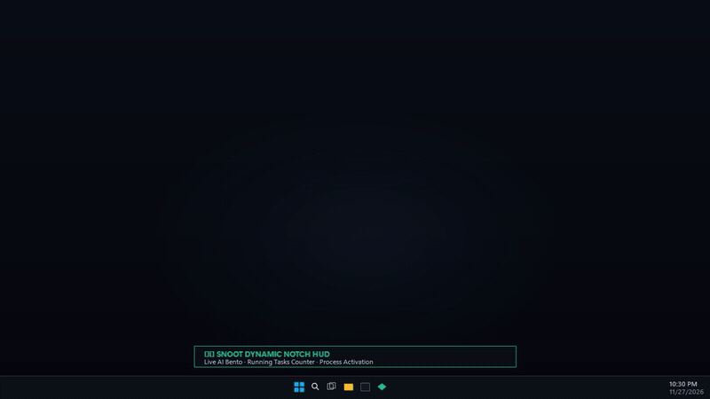
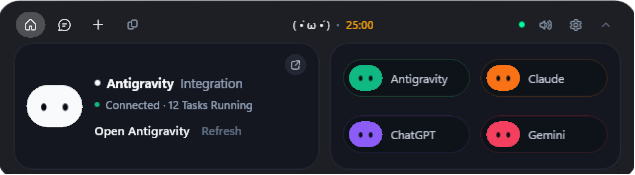

# LaunchMe OS

<p align="center">
  <a href="docs/assets/banner.mp4">
    
  </a>
</p>

<p align="center">
  <strong>Native Windows 11 Workspace Shell & Dynamic Ergonomics</strong><br>
  <em>Engineered in C# 13 and .NET 9 with WinUI 3 + Win2D, Squish Golden-Ratio BSP Tiling, Snoot Dynamic Notch HUD, and Pookie AI Agent Cockpit.</em>
</p>

<p align="center">
  <a href="#build--test-status"></a>
  <a href="#test-coverage"></a>
  <a href="#tech-stack"></a>
  <a href="#gpu-law"></a>
  <a href="#privacy--local-first"></a>
  <a href="LICENSE"></a>
</p>

---

## Quick Install

### Option 1: Windows Package Manager (Winget) — Recommended
```powershell
winget install LaunchMe.OS
```

### Option 2: 1-Click Installer
Download [`LaunchMe-Win-Setup-v1.0.0.exe`](https://github.com/redwan2003-bot/LaunchMe_OS/releases/latest) from the [Releases](https://github.com/redwan2003-bot/LaunchMe_OS/releases) page.

### Option 3: Portable ZIP (Zero Installation)
Download and unzip [`LaunchMe-Win-v1.0.0-Portable-x64.zip`](https://github.com/redwan2003-bot/LaunchMe_OS/releases/latest) and double-click `LaunchMe.UI.exe`. Fully self-contained — no .NET runtime or SDK required.

---

## Overview

**LaunchMe OS** is an ultra-fast, local-first Windows 11 desktop workspace shell crafted in **C# 13, .NET 9, WinUI 3, Win2D, and CsWin32**. It unifies high-craft fluid ergonomics, keyboard-driven productivity, and dynamic window management across six synchronized native surfaces:

1. **Crystal-Clear Full-Screen Launcher (`Alt+Space`):** Floating icon canvas with transparent acrylic depth, up-to-1024px G2 super-ellipse squircle icons, and instant Explorer file previews (`QLThumbnail`).
2. **Snoot Dynamic Notch HUD:** Symmetrical bento status island featuring live AI desktop app pills (**Antigravity**, **Claude**, **ChatGPT**, and **Gemini**), real-time running task counters, and the **Pookie** local AI agent approval cockpit.
3. **Multi-Display Dock:** Floating continuous G2 obsidian glass with hardware telemetry gauges and real-time 9-band procedural AudioDSP ambient soundscapes (rain, waves, forest) synthesized through pure math.
4. **Full-Screen Reactive Music Player:** Live album-art ambient backlighting derived from Windows GSMTC with 4 animated 30 FPS visualizer modes.
5. **Squish Dynamic Window Tiling Engine:** Golden-Ratio Binary Space Partitioning (BSP) window manager with atomic Win32 `DeferWindowPos` updates for zero-tearing window splits.
6. **Leash Cross-Device Relay:** AES-GCM 256-bit encrypted P2P mobile remote approval relay for reviewing CLI commands from your phone.

---

## Surface Breakdown

### 1. Crystal-Clear Full-Screen Launcher & Unified Search
- **Transparent Obsidian Depth:** Pure crystal background allows your desktop wallpaper to show through while icon pedestals and search inputs stay clear and legible.
- **1024px G2 Squircles:** High-resolution icon extraction via `IShellItemImageFactory` and `scale-400` MSIX assets, clipped to continuous G2 super-ellipses ($n=4.5$) with dynamic dominant-color backlighting.
- **QuickLook File Previews:** Sub-10ms search dropdown rendering high-resolution thumbnail previews for documents, PDFs, pictures, videos, and folders.
- **11 Widget Families:** 12 Clock styles, 9 Weather cards, 6 Music players, 18 looping Pixel Art animations, System Stats, Pomodoro timer, Calendar, Notes, and device battery indicators.

### 2. Snoot Dynamic Notch HUD & Pookie Agent Cockpit
<p align="center">
  
</p>

- **Live AI Desktop App Bento:** 4 symmetrical capsule pills for **Antigravity**, **Claude**, **ChatGPT**, and **Gemini**. Single-click brings running instances to the foreground via `SetForegroundWindow` and `ShowWindowAsync(SW_RESTORE)`.
- **Real-Time Task Polling:** Dynamic background task counter displaying live states like `Connected · 12 Tasks Running`.
- **Pookie Agent Approval Cockpit:** Local HTTP loopback server (port `49152`) securely intercepting agent actions from Antigravity, Claude Code, and terminal workflows. Approve actions with **Allow**, **Deny**, or **Always Allow** (regex rule persistence).
- **Blobbo Living Notch Companion:** Interactive emotional companion responding to pointer taps and cursor proximity.
- **Finder-Level Clipboard Drag-Out:** 7-category clipboard card manager allowing images and files to be dragged directly out of the HUD into external Windows applications.
- **Screen-Capture Exclusion:** Automatically masked from screen recording and screenshots via `WDA_EXCLUDEFROMCAPTURE`.

### 3. Multi-Display Dock
- **Continuous G2 Glass Capsule:** Win32 AppBar work-area reservation or floating mode with continuous DWM compositor spring hover waves (`1.42x` scaling curve).
- **Touch Bar Quick Actions:** Instant shortcuts for `Focus`, `Snap`, `Term`, `Lock`, and `Leash` P2P phone link.
- **Hardware Telemetry Gauges:** Real-time CPU usage %, RAM load %, and network throughput monitors.
- **9-Band Procedural AudioDSP:** Real-time mathematical audio synthesis generating *Rain*, *Ocean Waves*, *Forest*, *White Noise*, and *Campfire* with zero external audio files.

### 4. Full-Screen Music Player
- **Universal GSMTC Bridge:** Real-time synchronization with Spotify, Apple Music, YouTube Music, Tidal, Chrome, and Edge.
- **Dual-Color Reactive Aura:** WinRT `AlbumArtBitmapSource` extracting primary and secondary dominant colors to project a breathing ambient glow.
- **4 Visualizer Modes:** *Radial Aura*, *Frequency Bars*, *Waveform Ribbon*, and *Minimalist Vinyl* running at 30 FPS.
- **Strict 0% Idle GPU Law:** Automatic Pause-on-Hide detaches composition brushes when hidden or during fullscreen DirectX gaming.

### 5. Squish Dynamic Window Tiling Engine
- **Golden-Ratio BSP Dwindle Spiral:** Binary Space Partitioning window tiling along the golden ratio with reduced border gaps.
- **Atomic DeferWindowPos:** Multi-window layout repositioning committed in a single V-Sync frame with zero visual tearing or window flickering.
- **Workspace Switcher Hotkeys:** Dedicated workspace switching shortcuts (`Win+Alt+1` through `Win+Alt+9`) for multi-monitor setups.

---

## Keyboard Shortcuts

| Shortcut | Action | Surface |
| :--- | :--- | :--- |
| `Alt + Space` | Summon / Dismiss Full-Screen Launcher | Launcher |
| `Win + Alt + 1..9` | Switch between virtual workspace spaces | Squish Tiling |
| `Win + Shift + C` | Toggle Snoot Dynamic Notch Drawer | Snoot HUD |
| `Win + Shift + D` | Toggle Multi-Display Dock visibility | Dock |
| `Win + Shift + M` | Open Full-Screen Music Player | Music Player |
| `Win + Shift + Y` | Approve pending Pookie agent command | Pookie Cockpit |
| `Win + Shift + N` | Deny pending Pookie agent command | Pookie Cockpit |
| `Win + Ctrl + Arrow` | Move focused window to adjacent tiling split | Squish Tiling |

---

## System Architecture

```mermaid
flowchart TD
    subgraph Presentation_Layer ["Presentation & Composition Root (LaunchMe.UI)"]
        AppHost["Program.cs & App.xaml.cs (Self-Contained WinUI 3 + DI Root)"]
        LW["LauncherWindow (OverlappedPresenter + DesktopAcrylicBackdrop)"]
        NotchUI["NotchWindow (Snoot Dynamic Notch HUD + WDA_EXCLUDEFROMCAPTURE)"]
        DockUI["DockWindow (SHAppBarMessage Multi-Display Dock + Procedural AudioDSP)"]
        MusicUI["MusicPlayerWindow (Full-Screen GSMTC Player + Reactive Aura)"]
        VM["LauncherViewModel & NotchViewModel & DockViewModel & MusicPlayerViewModel"]
        GlassUI["LiquidGlassOverlayControl (Acrylic + Tint + Highlight)"]
        WidgetUI["Complete 11-Family Widget Catalog (18 PixelArt loops, Weather, Stats)"]
    end

    subgraph Contracts ["Frozen Contract Core (LaunchMe.Contracts)"]
        ISpace["ISpaceStore & ISpaceSchedulerService & IThemeAssociationService"]
        INotch["INotchWindowService & IPocketService"]
        IDock["IDockShellService & IDockSpaceService & IAmbientSoundService"]
        IMedia["IMediaSessionService & MusicVisualizerMode"]
        ITrigger["IGestureAndTriggerService & TriggerType (Pinch/Spread)"]
        ISearch["IFileSearchService & ICalculatorService & IEmojiService"]
        IApp["IAppIndexer & IAppLauncherService"]
        IClip["IClipboardMonitor & IClipboardWriter"]
        ITiling["ITilingEngine & IWindowRuleService & IFocusBorderService"]
        IAgent["IAgentApprovalService & IBlobboController & IDiffParserService"]
        IVoice["IFlowDictationService & IKeystrokeInjector & ILeashService"]
    end

    subgraph Core_Layer ["Core Engine (LaunchMe.Core)"]
        VoiceCore["FlowDictationService, LeashService & LeashCrypto (AES-GCM E2EE)"]
        AgentCore["AgentApprovalService, PookieHookServer, DiffParserService & BlobboController"]
        TilingCore["BSPTree, DwindleLayout, SlotMemory, WindowRuleService & SquishEngine"]
        Sqlite["SqliteSpaceStore, SpaceSchedulerService & SpaceLayoutSerializer"]
        ProceduralAudio["ProceduralAudioSynth (9-Band Math DSP) & AmbientSoundService"]
        AppIndex["AppIndexer, IconCacheService (1024px G2 Squircle) & CleanUninstall"]
        SearchEng["FileSearchService, InlineCalculatorService & EmojiService"]
    end

    subgraph Platform_Layer ["Win32 & WinRT Native Layer (LaunchMe.Platform.Win32)"]
        AppBar["Win32AppBarService (SHAppBarMessage + WorkArea Reservation)"]
        WinRTMedia["WinRTMediaSessionService (GlobalSystemMediaTransportControls)"]
        Hotkeys["Win32HotkeyService (RegisterHotKey / UnregisterHotKey)"]
        HotCorners["Win32HotCornerService (WH_MOUSE_LL Low-Level Hook)"]
        Touchpad["Win32TouchpadService (Raw Input HID Precision Touchpad)"]
        WinRTClip["WinRTClipboardMonitor (Clipboard.ContentChanged + DragPayloadHelper)"]
        Win32Icons["Win32ShellIconService (256px-1024px IShellItemImageFactory)"]
        FullscreenGame["Win32FullscreenGameDetector (SHQueryUserNotificationState)"]
        AudioDSP["WinRTAudioDspEngine (AudioGraph 9-Band Math Synth)"]
    end

    Presentation_Layer --> Contracts
    Contracts --> Core_Layer
    Contracts --> Platform_Layer
    Core_Layer --> Platform_Layer
```



---

## Security Architecture & Vulnerability Defenses

| Threat Vector | Mitigation Strategy | Enforcement & Verification |
| :--- | :--- | :--- |
| **Dependency CVEs** | Strict package curation and automated audits. | Zero known vulnerable packages (`dotnet list package --vulnerable`). |
| **E2EE Relay Tampering / Replay** | AES-GCM 256-bit authenticated encryption with 96-bit nonces. | `LeashCrypto` validates 128-bit auth tags and rejects duplicate nonces or corrupted payloads. |
| **Agent Hook Server RCE** | Localhost-only bind (`127.0.0.1:49152`) with strict payload validation. | `PookieHookServer` rejects external IP traffic; parses JSON strictly with timeout protection. |
| **Keystroke / Clipboard Leakage** | Dual-mode Unicode injection with state preservation. | `Win32KeystrokeInjector` backs up clipboard before multi-line paste and restores previous contents atomically. |
| **ZipSlip Path Traversal** | Extraction path validation against base canonical prefix. | `SqliteSpaceStore.ImportThemeAsync` validates canonical prefix and rejects `..` sequences. |
| **Shell Registry Injection** | Quote/newline validation and HKCU-only scoping. | `ThemeFileAssociationService.ValidateExecutablePath` validates path boundaries before writing `HKCU\Software\Classes`. |
| **Accidental / Traversal Deletion** | Target validation and root folder protection in clean uninstall. | `AppIndexer.CleanUninstallAsync` verifies subfolders strictly beneath `%LocalAppData%` / `%AppData%`. |
| **Expression Evaluation DoS** | Input length limits and max recursion depth tracking. | `InlineCalculatorService` rejects expressions exceeding 256 characters and bounds recursive descent to depth 32. |

---

## Building, Running, and Testing

### Prerequisites
- Windows 11 (Build 22621 / 22H2 or higher)
- [.NET 9.0 SDK](https://dotnet.microsoft.com/download/dotnet/9.0)

### Build the Solution
All projects enforce `<TreatWarningsAsErrors>true</TreatWarningsAsErrors>`:
```powershell
dotnet build LaunchMeWin.sln -warnaserror
```

### Launch the Desktop Application
```powershell
dotnet run --project src\LaunchMe.UI\LaunchMe.UI.csproj
```

### Run the Full Test Suite (569 Tests)
```powershell
dotnet test LaunchMeWin.sln --no-build
```

---

## License

LaunchMe OS is licensed under the [MIT License](LICENSE).
Copyright (c) 2026 Redwan Ahmmed.
