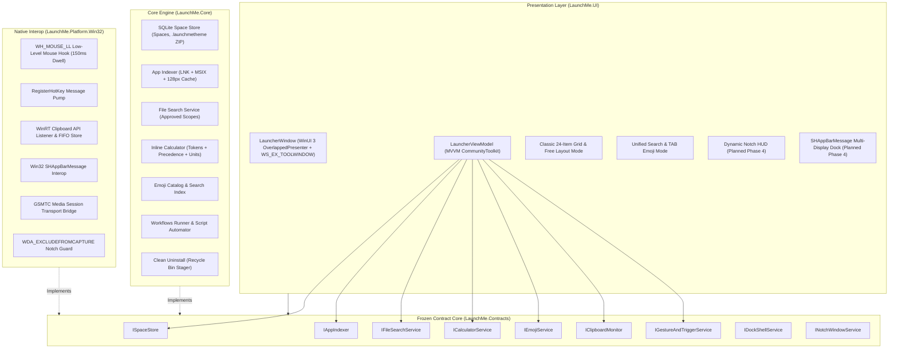

# LaunchMe-Win (LaunchMe OS)

<p align="center">
  
</p>

<p align="center">
  <strong>Native Windows 11 Workspace Manager & Full-Screen Shell</strong><br>
  <em>Achieving complete 1:1 feature parity with LaunchMe macOS v3.01.0</em>
</p>

<p align="center">
  <a href="#build--test-status"></a>
  <a href="#test-coverage"></a>
  <a href="#tech-stack"></a>
  <a href="#architecture-guardrails"></a>
  <a href="LICENSE"></a>
</p>

---

## Overview

**LaunchMe-Win** is an ultra-fast, local-first Windows 11 workspace manager crafted in **C# 13, .NET 9, WinUI 3, Win2D, and CsWin32**. It replicates the fluid ergonomics, design fidelity, and keyboard-centric workflows of LaunchMe v3.01.0 (macOS) while operating seamlessly with Windows native APIs.

### Key Pillars
- **Zero-Friction Launcher:** Full-screen blurred overlay summoned instantaneously on whichever monitor currently holds the mouse cursor (`MonitorFromPoint`).
- **Unified Search:** Real-time query dispatch combining Start Menu / MSIX applications, scoped local files, an inline scientific unit-converting calculator, Windows clipboard history, and a quick `TAB`-toggle emoji selector.
- **Hardware-Friendly ("Pause-on-Hide GPU Law"):** Render loops, video decoders, and background monitors pause immediately when the launcher is dismissed to ensure 0% background GPU consumption.
- **Strict Privacy:** Zero cloud telemetry or external network calls. All layout configurations, spaces, and clipboard history persist strictly in local SQLite and JSON.

---

## System Architecture



---

## Solution Layout

```
LaunchMe OS/
├── .agents/                        # Multi-agent roles & verification rules
├── docs/                           # PRD, Architecture, and Workstream specs
│   ├── ARCHITECTURE_AND_CONTRACTS.md
│   ├── PARALLEL_WORKSTREAMS.md
│   └── PRD_LAUNCHME_WINDOWS.md
├── src/
│   ├── LaunchMe.Contracts/         # Frozen interfaces & DTOs (Zero drift)
│   ├── LaunchMe.Core/              # SQLite, App/File indexing, Calculator, Workflows
│   ├── LaunchMe.Platform.Win32/    # CsWin32, WH_MOUSE_LL, Hotkeys, WinRT Clipboard
│   └── LaunchMe.UI/                # WinUI 3 Window, XAML Controls, Win2D Liquid Glass
└── tests/
    ├── LaunchMe.Core.Tests/        # 30 Unit Tests (xUnit + FluentAssertions)
    ├── LaunchMe.Platform.Tests/    # 36 Unit Tests (Win32 parsers & dwell tracking)
    └── LaunchMe.UI.Tests/          # 6 Unit Tests (MVVM & GPU Pause-on-Hide)
```

---

## Implementation Roadmap & Status

| Phase | Description | Status | Test Suites | Verification Gate |
| :---: | :--- | :---: | :---: | :---: |
| **Phase 0** | **Contract Freeze & Scaffolding**<br>Solution structure, `Directory.Build.props`, `<TreatWarningsAsErrors>`, frozen interfaces |  **Completed** | Verified | Zero Warnings |
| **Phase 1** | **Core Grid, Search, Indexers, Clipboard & Triggers**<br>WinUI 3 OverlappedPresenter, SQLite Spaces, Start Menu/MSIX indexer, Scoped Search, Inline Calc, WinRT Clipboard, `WH_MOUSE_LL` Hot Corners (150ms dwell), Hotkeys |  **Completed** | **72 / 72 Passing** | **PASS** (`qa-verifier-auditor`) |
| **Phase 2** | **Theming, Liquid Glass & Live Wallpapers**<br>Win2D Acrylic/Tint brush, Pause-on-Hide Media Foundation / WebM wallpaper renderer, 11 Widget families |  **In Queue** | Pending | Mandatory Gate |
| **Phase 3** | **Spaces & Workflows Engine**<br>Time/trigger Space switcher, `.launchmetheme` ZIP packager, Clean Uninstall with Recycle Bin recovery |  **Planned** | Pending | Mandatory Gate |
| **Phase 4** | **Dynamic Notch, Multi-Display Dock & Gestures**<br>`SHAppBarMessage` Dock, Dynamic Notch HUD (`WDA_EXCLUDEFROMCAPTURE`), GSMTC Music Player, HID touchpad pinch gestures |  **Planned** | Pending | Mandatory Gate |

---

## Verified Phase 1 Feature Capabilities

### 1. Unified Launcher Overlay
- Configured with `OverlappedPresenter` (`IsResizable=false`, `IsMaximizable=false`, `IsMinimizable=false`).
- Native Win32 window styles apply `WS_EX_TOOLWINDOW` to eliminate taskbar clutter and Alt-Tab pollution.
- Automatically queries mouse cursor position (`GetCursorPos`) and centers over target display (`MonitorFromPoint`).
- Strictly implements the **Pause-on-Hide GPU Law**: window dismissal signals `LauncherHidden`, immediately halting all transient UI tasks.

### 2. Multi-Engine Unified Search
- **Applications:** Scans both `CommonStartMenu` and `UserStartMenu` `.lnk` binaries (extracting 128px high-DPI icon bitmaps) + installed packaged MSIX apps via `PackageManager`.
- **Scoped Files:** Real-time fast directory traverser strictly constrained to user-approved folder scopes (preventing unsolicited drive scans).
- **Inline Calculator:** Evaluates mathematical expressions, precedence parentheses, trigonometric operations, and unit conversions (e.g. `10 km to miles`, `100 c to f`) on the fly.
- **Emoji Palette:** Instant toggling via `TAB` key query switcher into full Unicode emoji repository.
- **Clipboard History:** Captures and indexes WinRT clipboard changes into a categorized 500-slot FIFO store (`Text`, `Link`, `FilePath`, `ColorCode`, `CodeSnippet`).

### 3. Native Win32 Hooks & Gestures
- **Low-Level Mouse Hook (`WH_MOUSE_LL`):** Detects cursor entry into any of the 4 screen corners with a mandatory 150ms dwell timer to eliminate accidental activations.
- **Global Hotkey Daemon (`RegisterHotKey`):** Threaded hidden message pump registering custom user key combinations (e.g., `Win + Space`).
- **Deterministic Resource Management:** All hooks implement `IDisposable` with clean unhooking (`UnhookWindowsHookEx`, `UnregisterHotKey`) on shutdown.

---

## Building and Testing

### Prerequisites
- Windows 11 (Build 22621 / 22H2 or higher)
- [.NET 9.0 SDK](https://dotnet.microsoft.com/download/dotnet/9.0) (or .NET 10 with RollForward)
- Windows App SDK 1.6+ components

### Build the Solution
All projects are configured with `<TreatWarningsAsErrors>true</TreatWarningsAsErrors>`:
```powershell
dotnet build LaunchMeWin.sln -warnaserror
```

### Run the Full Test Suite
```powershell
dotnet test LaunchMeWin.sln --no-build
```

---

## Daily Update Log

### 2026-11-24
- **Scaffold & Contract Freeze (Phase 0):** Solution initialization, `.sln` and project configurations with `net9.0-windows10.0.22621.0`. All DTOs and contracts frozen in `LaunchMe.Contracts`.
- **Phase 1 Implementation Completed:**
  - Implemented `LaunchMe.Platform.Win32` (`WH_MOUSE_LL` hot corners, hotkeys, WinRT clipboard monitor, `SHAppBarMessage` dock scaffolding, `WDA_EXCLUDEFROMCAPTURE` notch window service).
  - Implemented `LaunchMe.Core` (SQLite space storage, app indexer, scoped file search, inline calculator, emoji catalog, workflow runner, recycle bin clean uninstaller).
  - Implemented `LaunchMe.UI` (WinUI 3 overlay window, `OverlappedPresenter`, cursor monitor positioning, MVVM unified search, GPU Pause-on-Hide integration).
- **QA Verification Gate Sign-Off:**
  - Independent auditor `qa-verifier-auditor` passed all 5 gates.
  - 72 / 72 unit tests passing with 0 compiler warnings.
- **GitHub Repository Sync:** Initialized synchronization with [redwan2003-bot/LaunchMe_OS](https://github.com/redwan2003-bot/LaunchMe_OS.git).

---

## License

This project is licensed under the [Boost Software License 1.0](LICENSE).
