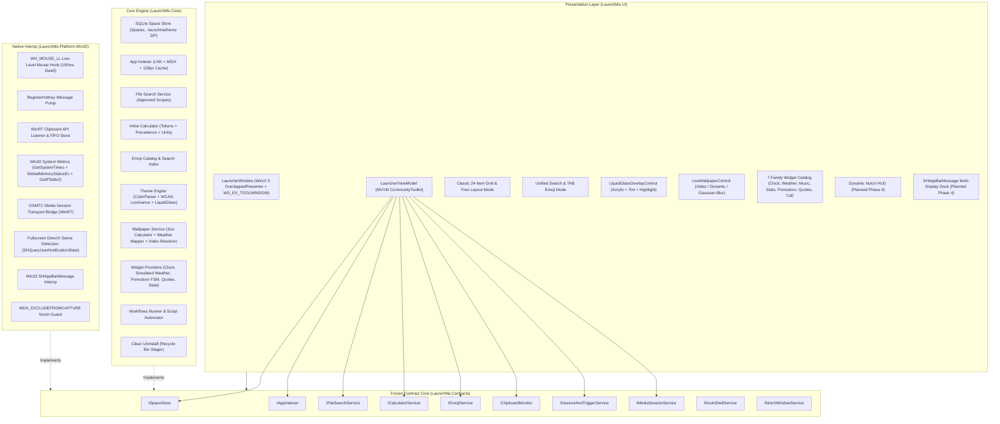

# LaunchMe-Win (LaunchMe OS)

<p align="center">
  
</p>

<p align="center">
  <strong>Native Windows 11 Workspace Manager & Full-Screen Shell</strong><br>
  <em>Achieving complete 1:1 feature parity with LaunchMe macOS v3.01.0</em>
</p>

<p align="center">
  <a href="#build--test-status"></a>
  <a href="#test-coverage"></a>
  <a href="#tech-stack"></a>
  <a href="#architecture-guardrails"></a>
  <a href="LICENSE"></a>
</p>

---

## Overview

**LaunchMe-Win** is an ultra-fast, local-first Windows 11 workspace manager crafted in **C# 13, .NET 9, WinUI 3, Win2D, and CsWin32**. It replicates the fluid ergonomics, design fidelity, and keyboard-centric workflows of LaunchMe v3.01.0 (macOS) while operating seamlessly with Windows native APIs.

### Key Pillars
- **Zero-Friction Launcher:** Full-screen blurred overlay summoned instantaneously on whichever monitor currently holds the mouse cursor (`MonitorFromPoint`).
- **Unified Search:** Real-time query dispatch combining Start Menu / MSIX applications, scoped local files, an inline scientific unit-converting calculator, Windows clipboard history, and a quick `TAB`-toggle emoji selector.
- **Liquid Glass Visual Engine:** Custom acrylic tint compositing, specular refraction, and automatic WCAG 2.1 contrast-checked title colors.
- **Hardware-Friendly ("Pause-on-Hide GPU Law"):** Render loops, video decoders, canvas shaders, and widget timers pause immediately when the launcher is dismissed to ensure 0% background GPU consumption.
- **Strict Privacy:** Zero cloud telemetry or external network calls. All layout configurations, spaces, and clipboard history persist strictly in local SQLite and JSON.

---

## System Architecture



---

## Solution Layout

```
LaunchMe OS/
├── .agents/                        # Multi-agent roles & verification rules
├── docs/                           # PRD, Architecture, and Workstream specs
│   ├── ARCHITECTURE_AND_CONTRACTS.md
│   ├── PARALLEL_WORKSTREAMS.md
│   └── PRD_LAUNCHME_WINDOWS.md
├── src/
│   ├── LaunchMe.Contracts/         # Frozen interfaces & DTOs (Zero drift)
│   ├── LaunchMe.Core/              # SQLite, App/File indexers, Themes, Wallpapers, Widgets
│   ├── LaunchMe.Platform.Win32/    # CsWin32, WH_MOUSE_LL, Hotkeys, WinRT Clipboard, GSMTC, Metrics
│   └── LaunchMe.UI/                # WinUI 3 Window, Liquid Glass, Live Wallpaper, 7 Widget Views
└── tests/
    ├── LaunchMe.Core.Tests/        # 127 Unit Tests (xUnit + FluentAssertions)
    ├── LaunchMe.Platform.Tests/    # 66 Unit Tests (Win32 parsers, GSMTC, metrics, dwell)
    └── LaunchMe.UI.Tests/          # 50 Unit Tests (MVVM, GPU Pause-on-Hide, Widgets, Theming)
```

---

## Implementation Roadmap & Status

| Phase | Description | Status | Test Suites | Verification Gate |
| :---: | :--- | :---: | :---: | :---: |
| **Phase 0** | **Contract Freeze & Scaffolding**<br>Solution structure, `Directory.Build.props`, `<TreatWarningsAsErrors>`, frozen interfaces |  **Completed** | Verified | Zero Warnings |
| **Phase 1** | **Core Grid, Search, Indexers, Clipboard & Triggers**<br>WinUI 3 OverlappedPresenter, SQLite Spaces, Start Menu/MSIX indexer, Scoped Search, Inline Calc, WinRT Clipboard, `WH_MOUSE_LL` Hot Corners (150ms dwell), Hotkeys |  **Completed** | **72 / 72 Passing** | **PASS** (`qa-verifier-auditor`) |
| **Phase 2** | **Theming, Liquid Glass, Live Wallpapers & Core Widgets**<br>Liquid Glass acrylic & tint engine, Pause-on-Hide live video wallpapers, 7 widget families, GSMTC media bridge, native Win32 hardware metrics, DirectX fullscreen game detection |  **Completed** | **243 / 243 Passing** | **PASS** (`qa-verifier-auditor`) |
| **Phase 3** | **Spaces & Workflows Engine**<br>Time/trigger Space switcher, `.launchmetheme` ZIP packager, Clean Uninstall with Recycle Bin recovery |  **Planned** | Pending | Mandatory Gate |
| **Phase 4** | **Dynamic Notch, Multi-Display Dock & Gestures**<br>`SHAppBarMessage` Dock, Dynamic Notch HUD (`WDA_EXCLUDEFROMCAPTURE`), GSMTC Music Player, HID touchpad pinch gestures |  **Planned** | Pending | Mandatory Gate |

---

## Verified Phase 1 & Phase 2 Feature Capabilities

### 1. Liquid Glass & Theming Engine
- **Flexible Color Parser:** Zero-allocation hexadecimal color parser supporting `#RGB`, `#RGBA`, `#RRGGBB`, and `#AARRGGBB` notations.
- **WCAG 2.1 Contrast & Luminance:** Computes relative luminance ($L = 0.2126 R_{lin} + 0.7152 G_{lin} + 0.0722 B_{lin}$) and contrast ratio ($CR \in [1, 21]$) to resolve Auto title colors (white vs. dark text) for optimal readability.
- **Acrylic Backdrop & Refraction:** Layered WinUI 3 control compositing acrylic blur base, edge highlight, and tint overlays with configurable intensity.

### 2. Pause-on-Hide Live Wallpapers
- **Solar Equation Calculator:** Computes solar declination, equation of time, solar noon, sunrise, sunset, elevation, and azimuth with 16-slice time-of-day dynamic wallpaper progression.
- **Weather Condition Mapper:** Normalizes 25+ weather condition strings into canonical day/night wallpaper candidates.
- **Hardware-Friendly ("Pause-on-Hide GPU Law"):** Integrates `MediaPlayerElement` for video wallpapers (`.mp4`, `.mov`, `.avi`, `.mkv`, `.webm`); halts video decoding and canvas rendering immediately upon `LauncherHidden` to ensure 0.0% background GPU load.

### 3. Interactive 7-Family Widget Catalog
- **Clock Widget:** 12h/24h digital formatting and analog hand angle trigonometry; tick timer pauses when hidden.
- **Weather Widget:** Metric/Imperial temperature toggle (°C / °F), condition glyph mapping, 4-day forecast strip.
- **Music Widget (mini GSMTC):** Real-time track title, artist, album art streaming, progress interpolation, and interactive playback controls (Play/Pause, Next, Prev, Seek).
- **System Stats Widget:** Real-time CPU, RAM, and Network meters with Green/Amber/Red health alert thresholds.
- **Pomodoro Widget:** State machine for 25m work / 5m break / 15m long break cycles, audio cue notifications, and wall-clock catch-up.
- **Affirmations Widget:** Daily rotating inspiration and focus quotes with custom quote staging.
- **Calendar Widget:** 6x7 42-day calendar matrix with month navigation and today indicator.

### 4. Native Win32 Metrics & Media Bridge
- **Hardware Performance Counters:** CPU utilization via `GetSystemTimes` differential calculation, memory status via `GlobalMemoryStatusEx`, and network interface throughput via `GetIfTable2`.
- **GSMTC Media Bridge:** WinRT `GlobalSystemMediaTransportControlsSessionManager` integration for Universal Windows media synchronization.
- **Fullscreen DirectX Game Detection:** Evaluates `SHQueryUserNotificationState(QUNS_RUNNING_D_3D_FULL_SCREEN)` and DWM frame bounds (`DWMWA_EXTENDED_FRAME_BOUNDS`) to prevent unintended invocations during fullscreen 3D gameplay.

### 5. Multi-Engine Unified Search & Hotkeys
- **Applications & Scoped Files:** Start Menu / MSIX applications query + scoped directory search.
- **Inline Calculator & Emojis:** Mathematical expression evaluation and `TAB`-toggle emoji palette.
- **Clipboard Monitor:** 500-slot FIFO store with content classification (`Text`, `Link`, `FilePath`, `ColorCode`, `CodeSnippet`).
- **Low-Level Mouse Hook (`WH_MOUSE_LL`):** 150ms dwell corner triggers and global `RegisterHotKey` message pump with deterministic `IDisposable` unhooking.

---

## Building and Testing

### Prerequisites
- Windows 11 (Build 22621 / 22H2 or higher)
- [.NET 9.0 SDK](https://dotnet.microsoft.com/download/dotnet/9.0) (or .NET 10 with RollForward)
- Windows App SDK 1.6+ components

### Build the Solution
All projects are configured with `<TreatWarningsAsErrors>true</TreatWarningsAsErrors>`:
```powershell
dotnet build LaunchMeWin.sln -warnaserror
```

### Run the Full Test Suite
```powershell
dotnet test LaunchMeWin.sln --no-build
```

---

## Daily Update Log

### 2026-11-24
- **Scaffold & Contract Freeze (Phase 0):** Solution initialization, `.sln` and project configurations with `net9.0-windows10.0.22621.0`. All DTOs and contracts frozen in `LaunchMe.Contracts`.
- **Phase 1 Implementation Completed:**
  - Implemented `LaunchMe.Platform.Win32` (`WH_MOUSE_LL` hot corners, hotkeys, WinRT clipboard monitor, `SHAppBarMessage` dock scaffolding, `WDA_EXCLUDEFROMCAPTURE` notch window service).
  - Implemented `LaunchMe.Core` (SQLite space storage, app indexer, scoped file search, inline calculator, emoji catalog, workflow runner, recycle bin clean uninstaller).
  - Implemented `LaunchMe.UI` (WinUI 3 overlay window, `OverlappedPresenter`, cursor monitor positioning, MVVM unified search, GPU Pause-on-Hide integration).
- **Phase 2 Implementation Completed (Multi-Agent Swarm):**
  - Implemented Liquid Glass acrylic backdrop & custom tint engine with WCAG 2.1 contrast calculations.
  - Implemented Pause-on-Hide Live Wallpaper component with dynamic Sun NOAA calculations and video decoding suspension.
  - Implemented 7-family interactive Widget Catalog (Clock, Weather, GSMTC Music, System Stats, Pomodoro, Quotes, Calendar).
  - Implemented native Win32 performance counters (`GetSystemTimes`, `GlobalMemoryStatusEx`, `GetIfTable2`), GSMTC media transport bridge, and DirectX fullscreen game detection.
- **QA Verification Gate Sign-Off:**
  - Independent auditor `qa-verifier-auditor` passed all 5 gates.
  - **243 / 243 unit tests passing** with 0 compiler warnings.
- **GitHub Repository Sync:** Synchronized with [redwan2003-bot/LaunchMe_OS](https://github.com/redwan2003-bot/LaunchMe_OS.git).

---

## License

This project is licensed under the [Boost Software License 1.0](LICENSE).
