# LaunchMe-Win (LaunchMe OS)

<p align="center">
  
</p>

<p align="center">
  <strong>Native Windows 11 Workspace Manager & Full-Screen Shell</strong><br>
  <em>Achieving complete 1:1 feature parity with LaunchMe macOS v3.01.0</em>
</p>

<p align="center">
  <a href="#build--test-status"></a>
  <a href="#test-coverage"></a>
  <a href="#tech-stack"></a>
  <a href="#security-architecture--vulnerability-defenses"></a>
  <a href="#architecture-guardrails"></a>
  <a href="LICENSE"></a>
</p>

---

## Overview

**LaunchMe-Win** is an ultra-fast, local-first Windows 11 workspace manager crafted in **C# 13, .NET 9, WinUI 3, Win2D, and CsWin32**. It replicates the fluid ergonomics, design fidelity, and keyboard-centric workflows of LaunchMe v3.01.0 (macOS) while operating seamlessly with Windows native APIs.

### Key Pillars
- **Zero-Friction Runnable Desktop Shell:** Self-contained WinUI 3 application (`Alt+Space` global hotkey, Hot Corners, and System Tray icon) summoned instantaneously on whichever monitor currently holds the mouse cursor (`MonitorFromPoint`).
- **Unified Search & Direct Execution:** Real-time query dispatch combining Start Menu / MSIX applications (live launching), Workflows, scoped local files (open / reveal / copy), inline unit-converting calculator (click-to-copy), Windows clipboard history, and a `TAB`-toggle emoji palette.
- **Automated Spaces & `.launchmetheme` Packaging:** Scheduled day/time Space switching (`SpaceSchedulerService`), double-click Windows shell `.launchmetheme` association, and portable ZIP export/import.
- **Full 11-Family Widget Catalog & Liquid Glass:** Real `DesktopAcrylicBackdrop` + custom HEX tinting, WCAG 2.1 auto contrast, and all 11 widget families (including 18 Pixel Art loops, Photo, Shape Photo, and GIF).
- **Hardware-Friendly ("Pause-on-Hide GPU Law"):** Render loops, video decoders, GIF animations, Pixel Art frames, and widget timers pause immediately when the launcher is dismissed (`0%` idle GPU).
- **Strict Privacy:** Zero cloud telemetry or external network calls. All layout configurations, spaces, and clipboard history persist strictly in local SQLite and JSON.

---

## System Architecture

```mermaid
flowchart TD
    subgraph UI_Layer ["Presentation & Composition Root (LaunchMe.UI)"]
        AppHost["Program.cs & App.xaml.cs (Self-Contained WinUI 3 + --import-theme + DI Root)"]
        LW["LauncherWindow (OverlappedPresenter + DesktopAcrylicBackdrop + WS_EX_TOOLWINDOW)"]
        VM["LauncherViewModel (Spaces, Categories, Workflows, Folders, Diagnostics, IDisposable)"]
        GlassUI["LiquidGlassOverlayControl (Acrylic + Tint + Highlight)"]
        WallUI["LiveWallpaperControl (Pause-on-Hide Video / Dynamic / Blur)"]
        WidgetUI["Complete 11-Family Widget Catalog (Clock, Weather, Music, Stats, Pomodoro, Quotes, Cal, PixelArt, Photo, ShapePhoto, GIF)"]
        Adapters["Win32SystemStatsAdapter & CoreWeatherAdapter"]
        NotchUI["Dynamic Notch HUD (Planned Phase 4)"]
        DockUI["SHAppBarMessage Multi-Display Dock (Planned Phase 4)"]
    end

    subgraph Contracts ["Frozen Contract Core (LaunchMe.Contracts)"]
        ISpace["ISpaceStore & ISpaceSchedulerService & IThemeAssociationService"]
        IApp["IAppIndexer & IAppLauncherService"]
        ISearch["IFileSearchService & ICalculatorService & IEmojiService"]
        IWork["IWorkflowRunner"]
        IClip["IClipboardMonitor & IClipboardWriter"]
        IGesture["IGestureAndTriggerService & ISystemTrayService"]
        IMedia["IMediaSessionService"]
        IDock["IDockShellService & INotchWindowService"]
    end

    subgraph Core_Layer ["Core Engine (LaunchMe.Core)"]
        Sqlite["SqliteSpaceStore, SpaceSchedulerService & SpaceLayoutSerializer"]
        AppIdx["AppIndexer (Categories/Leftover Preview), AppLauncherService & Clean Uninstall"]
        FileIdx["FileSearchService (Approved Scopes + Clipboard Copy)"]
        CalcEng["InlineCalculatorService & EmojiIndexService"]
        ThemeEng["ThemeEngineService (ColorParser + WCAG Luminance + LiquidGlass)"]
        WallEng["WallpaperService (NOAA Sun Calculator + Weather Mapper + Video Resolver)"]
        WidgetCore["Widget Providers (Clock, SimulatedWeatherProvider, Pomodoro FSM, Quotes)"]
        Workflow["WorkflowRunner (Validation + Secure HTTP/HTTPS Launch)"]
    end

    subgraph Platform_Layer ["Native Interop (LaunchMe.Platform.Win32)"]
        Tray["SystemTrayService (Shell_NotifyIconW + TrackPopupMenu)"]
        ThemeReg["ThemeFileAssociationService (HKCU .launchmetheme + SHChangeNotify)"]
        Diag["PlatformDiagnosticsService (GetDpiForSystem + EnumDisplayMonitors + Elevation)"]
        HotCorners["WH_MOUSE_LL Low-Level Mouse Hook (150ms Dwell)"]
        Hotkeys["Win32HotkeyService (RegisterHotKey + Clean WM_DESTROY Exit)"]
        ClipMon["WinRTClipboardMonitor & Win32ClipboardWriter (CF_UNICODETEXT / CF_HDROP)"]
        Metrics["Win32SystemMetricsService (GetSystemTimes + GlobalMemoryStatusEx + GetIfTable2)"]
        MediaCtl["WinRTMediaSessionService (WinRT GSMTC Bridge)"]
        GameDetect["Fullscreen DirectX Game Detection & AppBar / Notch Interop"]
    end

    AppHost --> LW
    AppHost --> Adapters
    UI_Layer --> Contracts
    Core_Layer -.->|Implements| Contracts
    Platform_Layer -.->|Implements| Contracts
    VM --> ISpace
    VM --> IApp
    VM --> ISearch
    VM --> IWork
    VM --> IClip
    Adapters --> Metrics
    Adapters --> WidgetCore
```



---

## Solution Layout

```
LaunchMe OS/
├── .agents/                        # Multi-agent roles & verification rules
├── docs/                           # PRD, Architecture, and Workstream specs
│   ├── ARCHITECTURE_AND_CONTRACTS.md
│   ├── PARALLEL_WORKSTREAMS.md
│   └── PRD_LAUNCHME_WINDOWS.md
├── src/
│   ├── LaunchMe.Contracts/         # Frozen interfaces & DTOs (Zero drift)
│   ├── LaunchMe.Core/              # SQLite, SpaceScheduler, AppIndexer/Launcher, Themes, Wallpapers, Workflows
│   ├── LaunchMe.Platform.Win32/    # CsWin32, WH_MOUSE_LL, Hotkeys, Tray, .launchmetheme Reg, Diagnostics, GSMTC, Metrics
│   └── LaunchMe.UI/                # Self-contained WinUI 3 EXE, App DI Root, Acrylic, 11 Widgets, Wallpaper, Spaces/Workflows UI
└── tests/
    ├── LaunchMe.Core.Tests/        # 180 Unit Tests (Spaces, Scheduler, Workflows, Security, Themes, Wallpapers, Widgets)
    ├── LaunchMe.Platform.Tests/    # 104 Unit Tests (Win32 hooks, Tray, HKCU Assoc, Diagnostics, ClipboardWriter, GSMTC, Metrics)
    └── LaunchMe.UI.Tests/          # 77 Unit Tests (MVVM, --import-theme CLI, Adapters, GPU Pause-on-Hide, 11 Widgets)
```

---

## Implementation Roadmap & Status

| Phase | Description | Status | Test Suites | Verification Gate |
| :---: | :--- | :---: | :---: | :---: |
| **Phase 0** | **Contract Freeze & Scaffolding**<br>Solution structure, `Directory.Build.props`, `<TreatWarningsAsErrors>`, frozen interfaces | **Completed** | Verified | Zero Warnings |
| **Phase 1** | **Core Grid, Search, Indexers, Clipboard & Triggers**<br>WinUI 3 OverlappedPresenter, SQLite Spaces, Start Menu/MSIX indexer, Scoped Search, Inline Calc, WinRT Clipboard, `WH_MOUSE_LL` Hot Corners (150ms dwell), Hotkeys | **Completed** | **72 / 72 Passing** | **PASS** (`qa-verifier-auditor`) |
| **Phase 2** | **Theming, Liquid Glass, Live Wallpapers & Core Widgets**<br>Liquid Glass acrylic & tint engine, Pause-on-Hide live video wallpapers, 7 widget families, GSMTC media bridge, native Win32 hardware metrics, DirectX fullscreen game detection | **Completed** | **248 / 248 Passing** | **PASS** (`qa-verifier-auditor` + Security Audit) |
| **Phase 2.5** | **Desktop Integration & Runnable App Bootstrapping**<br>Self-contained WinUI 3 `App.xaml` DI root, `SystemTrayService`, `AppLauncherService`, `Win32ClipboardWriter`, `SpaceLayoutSerializer`, `DesktopAcrylicBackdrop`, live Widget Catalog drawer, Folder & Settings/Diagnostics UI, deterministic `IDisposable` cleanup | **Completed** | **306 / 306 Passing** | **PASS** (`qa-verifier-auditor` + `--smoke-test`) |
| **Phase 3** | **Spaces Scheduler, Workflows UI, `.launchmetheme` Shell Association & Complete 11-Widget Catalog**<br>`SpaceSchedulerService` daemon, `WorkflowRunner` + quick-launch UI, HKCU `.launchmetheme` double-click registration + `--import-theme` CLI, Categories & Clean Uninstall leftover preview, `PlatformDiagnosticsService`, and Pixel Art (18 loops), Photo, Shape Photo (6 masks), and Pause-on-Hide GIF widgets | **Completed** | **361 / 361 Passing** | **PASS** (`qa-verifier-auditor` + `--smoke-test`) |
| **Phase 4** | **Dynamic Notch, Multi-Display Dock, Music Player & HID Gestures**<br>`SHAppBarMessage` Dock UI, Dynamic Notch HUD (`WDA_EXCLUDEFROMCAPTURE`) + Pocket/Share, Full-Screen Music Player, Raw Input HID touchpad pinch gestures | **Planned** | Pending | Mandatory Gate |

---

## Verified Phase 1–3 Feature Capabilities

### 1. Runnable Self-Contained WinUI 3 Shell, System Tray & `--import-theme`
- **Instant Desktop Boot (`Program.cs` & `App.xaml.cs`):** Self-contained Windows App SDK 1.6 runtime composing SQLite, `SpaceSchedulerService`, `AppIndexer`, `AppLauncherService`, `WorkflowRunner`, `ThemeFileAssociationService`, `PlatformDiagnosticsService`, `Win32SystemMetricsService`, `WinRTMediaSessionService`, `GestureAndTriggerService` (`Alt+Space` + Top-Left Hot Corner), and `SystemTrayService`.
- **`.launchmetheme` Windows Shell Association:** `ThemeFileAssociationService` registers HKCU `.launchmetheme` (`LaunchMeWin.Theme`) without requiring UAC elevation; double-clicking or passing `--import-theme "<path>"` safely imports and activates valid `.launchmetheme` bundles while rejecting invalid/corrupt files cleanly.
- **Direct Launch & Clipboard Actions:** Clicking indexed apps launches Win32 shortcuts, EXEs, or packaged MSIX apps (`PackageManager`); clicking Calculator, Emoji, or Clipboard search hits copies values cleanly via `Win32ClipboardWriter` (`CF_UNICODETEXT` / `CF_HDROP`).

### 2. Automated Spaces, Workflows, Categories & Clean Uninstall
- **Space Scheduler (`SpaceSchedulerService`):** Evaluates weekday and `HH:mm` windows (including overnight ranges) on a 30s `PeriodicTimer`, switching active Spaces automatically and synchronizing UI themes, wallpapers, and workflows.
- **Categories & Clean Uninstall (`AppIndexer`):** Filters apps by `All`, `Recently Used`, `Hidden`, and discovered categories (`Development`, `Browsers`, `Media`, `Productivity`), plus path-traversal-guarded `PreviewUninstallLeftovers` and Recycle Bin staging.
- **Workflows Engine (`WorkflowRunner`):** Validates multi-step launch presets, enforces strict `http`/`https` scheme allowlisting, and integrates matching workflows into Unified Search and quick-launch UI.

### 3. Complete 11-Family Widget Catalog & Liquid Glass
- **Windows 11 Acrylic + Tint Engine:** Applies `DesktopAcrylicBackdrop` beneath WCAG 2.1 contrast-checked tint overlays.
- **All 11 Widget Families Hosted (`WidgetCatalogView`):** Clock, Weather (`CoreWeatherAdapter`), GSMTC Music, System Stats (`Win32SystemStatsAdapter` reading live `Win32SystemMetricsService`), Pomodoro, Affirmations, Calendar, **Pixel Art** (18 animated loops), **Photo** (4 sizes + HEX fill), **Shape Photo** (6 geometric masks), and **GIF** (animated loop).
- **Pause-on-Hide GPU Law:** Video wallpapers (`MediaPlayerElement`), GIF playback (`BitmapImage.Stop()`), Pixel Art frame timers, and all widget polling timers halt immediately on `LauncherHidden` (`0.0%` idle GPU).

---

## Security Architecture & Vulnerability Defenses

| Threat Vector | Mitigation Strategy | Enforcement & Verification |
| :--- | :--- | :--- |
| **Dependency CVEs** | Strict package curation and automated audits. | Zero known vulnerable packages identified by `dotnet list package --vulnerable`. |
| **ZipSlip Path Traversal** | Extraction path validation against base canonical prefix. | `SqliteSpaceStore.ImportThemeAsync` validates `Path.GetFullPath(targetPath).StartsWith(assetsDir)` and rejects any entry with `..` sequences. |
| **CLI Theme Import Validation** | Extension, flag, path, and corrupt archive error guards. | `Program.ExtractImportThemePath` & `ImportThemePackage` enforce `.launchmetheme`, reject `-` flags, normalize full paths, and handle corrupt ZIPs without crashing. |
| **Shell Registry Injection** | Quote/newline validation and HKCU-only scoping. | `ThemeFileAssociationService.ValidateExecutablePath` rejects quotes, control chars, and relative paths before writing `HKCU\Software\Classes`. |
| **Accidental / Traversal Deletion** | Target validation and root folder protection in clean uninstall. | `AppIndexer.CleanUninstallAsync` & `PreviewUninstallLeftovers` verify subfolders strictly beneath `%LocalAppData%` / `%AppData%`. |
| **Workflow Command Injection** | URL scheme whitelisting for `OpenUrl` and `LaunchTarget` actions. | `WorkflowRunner` and `AppLauncherService` restrict URL launches strictly to `http://` or `https://` schemes, prohibiting malicious protocol handlers. |
| **Explorer Argument Breakout** | Stripping double quotes from paths in `RevealInExplorer`. | `FileSearchService.RevealInExplorer` strips quotes from the resolved path prior to spawning `explorer.exe /select,"path"`. |
| **Expression Evaluation DoS** | Input length limits and max recursion depth tracking. | `InlineCalculatorService` rejects expressions exceeding 256 characters and bounds recursive descent to a depth of 32 to prevent StackOverflow crashes. |
| **Memory Bloat & Exhaustion** | Clipboard payload truncation for massive text entries. | `WinRTClipboardMonitor` caps text payloads to 100,000 characters prior to storage. |

---

## Building, Running, and Testing

### Prerequisites
- Windows 11 (Build 22621 / 22H2 or higher)
- [.NET 9.0 SDK](https://dotnet.microsoft.com/download/dotnet/9.0) (or .NET 10 with RollForward)

### Build the Solution
All projects enforce `<TreatWarningsAsErrors>true</TreatWarningsAsErrors>`:
```powershell
dotnet build LaunchMeWin.sln -warnaserror
```

### Run Headless Integration Smoke Test
```powershell
& "src\LaunchMe.UI\bin\x64\Debug\net9.0-windows10.0.22621.0\LaunchMe.UI.exe" --smoke-test
```

### Launch the Desktop Application
```powershell
dotnet run --project src\LaunchMe.UI\LaunchMe.UI.csproj
```

### Run the Full Test Suite (361 Tests)
```powershell
dotnet test LaunchMeWin.sln --no-build
```

---

## Daily Update Log

### 2026-11-25
- **Phase 2.5 Integration Sprint Completed:** Self-contained WinUI 3 entrypoint (`Program.cs`, `App.xaml`, `App.xaml.cs`), `SystemTrayService`, `AppLauncherService`, `Win32ClipboardWriter`, `SpaceLayoutSerializer`, `DesktopAcrylicBackdrop`, `Win32SystemStatsAdapter`, `CoreWeatherAdapter`, Folder/Settings UI, and `IDisposable` pump/UI hardening (**306 / 306 tests passing**).
- **Phase 3 Parity Completed (Multi-Agent Swarm):**
  - **Core (`LaunchMe.Core`):** Implemented `SpaceSchedulerService` (weekday/HH:mm + overnight schedule evaluation), upgraded `WorkflowRunner` (`ValidateWorkflow` + `IAppLauncherService` delegation), and expanded `AppIndexer` (`GetAppsByCategory`, `GetCategories`, `PreviewUninstallLeftovers`).
  - **Win32 Platform (`LaunchMe.Platform.Win32`):** Implemented HKCU `.launchmetheme` double-click shell association (`ThemeFileAssociationService`) and `PlatformDiagnosticsService` (`GetDpiForSystem`, monitor count, elevation).
  - **UI (`LaunchMe.UI`):** Implemented remaining 4 widget families (`PixelArt` with 18 presets, `Photo`, `ShapePhoto` with 6 masks, and Pause-on-Hide `Gif`) completing all **11 widget families**, wired Category tabs, Space switcher/scheduler/association controls, Workflows quick-launch & search integration, and `--import-theme` CLI support.
  - **QA Audit & Verification:** Resolved all QA static/UI-thread continuation findings (`App.xaml.cs` scheduler guard, `Program.cs` `--import-theme` hardening, `LauncherViewModel` UI-context awaits, `PixelArt`/`Gif` disposal hardening); `qa-verifier-auditor` signed off **PASS**; `dotnet build LaunchMeWin.sln -warnaserror` (`0 Warnings, 0 Errors`), **361 / 361 unit tests passing**, zero stubs, and `LaunchMe.UI.exe --smoke-test` -> `SMOKE_TEST_OK` (`EXIT_CODE=0`).

### 2026-11-24
- **Phases 0, 1, 2 & Security Hardening:** Scaffolded `.sln` + frozen Contracts, SQLite spaces, app/file search, hotkeys/hot corners, WinRT clipboard, Liquid Glass, Pause-on-Hide wallpapers, initial 7 widgets, GSMTC, Win32 metrics, and ZipSlip/traversal/DoS security hardening (**248 / 248 tests passing**).
- **GitHub Repository Sync:** Synchronized with [redwan2003-bot/LaunchMe_OS](https://github.com/redwan2003-bot/LaunchMe_OS.git).

---

## License

This project is licensed under the [Boost Software License 1.0](LICENSE).
