# LaunchMe-Win (LaunchMe OS)

<p align="center">
  
</p>

<p align="center">
  <strong>Native Windows 11 Workspace Manager & Full-Screen Shell</strong><br>
  <em>Achieving complete 1:1 feature parity with LaunchMe macOS v3.01.0</em>
</p>

<p align="center">
  <a href="#build--test-status"></a>
  <a href="#test-coverage"></a>
  <a href="#tech-stack"></a>
  <a href="#security-architecture--vulnerability-defenses"></a>
  <a href="#architecture-guardrails"></a>
  <a href="LICENSE"></a>
</p>

---

## Overview

**LaunchMe-Win** is an ultra-fast, local-first Windows 11 workspace manager crafted in **C# 13, .NET 9, WinUI 3, Win2D, and CsWin32**. It replicates the fluid ergonomics, design fidelity, and keyboard-centric workflows of LaunchMe v3.01.0 (macOS) while operating seamlessly with Windows native APIs.

### Key Pillars
- **Zero-Friction Runnable Desktop Shell:** Self-contained WinUI 3 application (`Alt+Space` global hotkey, Hot Corners, and System Tray icon) summoned instantaneously on whichever monitor currently holds the mouse cursor (`MonitorFromPoint`).
- **Unified Search & Direct Execution:** Real-time query dispatch combining Start Menu / MSIX applications (live launching), scoped local files (open / reveal / copy), inline unit-converting calculator (click-to-copy), Windows clipboard history, and a `TAB`-toggle emoji palette.
- **Liquid Glass Visual Engine:** Real `DesktopAcrylicBackdrop` layered beneath custom tint compositing, specular refraction, and automatic WCAG 2.1 contrast-checked title colors.
- **Hardware-Friendly ("Pause-on-Hide GPU Law"):** Render loops, video decoders, canvas shaders, and all 7 widget timers pause immediately when the launcher is dismissed to ensure 0% background GPU consumption.
- **Strict Privacy:** Zero cloud telemetry or external network calls. All layout configurations, spaces, and clipboard history persist strictly in local SQLite and JSON.

---

## System Architecture

```mermaid
flowchart TD
    subgraph UI_Layer ["Presentation & Composition Root (LaunchMe.UI)"]
        AppHost["Program.cs & App.xaml.cs (Self-Contained WinUI 3 + DI Root)"]
        LW["LauncherWindow (OverlappedPresenter + DesktopAcrylicBackdrop + WS_EX_TOOLWINDOW)"]
        VM["LauncherViewModel (Apps, Folders, Settings, Diagnostics, IDisposable)"]
        GlassUI["LiquidGlassOverlayControl (Acrylic + Tint + Highlight)"]
        WallUI["LiveWallpaperControl (Pause-on-Hide Video / Dynamic / Blur)"]
        WidgetUI["7-Family Widget Catalog Drawer (Clock, Weather, Music, Stats, Pomodoro, Quotes, Cal)"]
        Adapters["Win32SystemStatsAdapter & CoreWeatherAdapter"]
        NotchUI["Dynamic Notch HUD (Planned Phase 4)"]
        DockUI["SHAppBarMessage Multi-Display Dock (Planned Phase 4)"]
    end

    subgraph Contracts ["Frozen Contract Core (LaunchMe.Contracts)"]
        ISpace["ISpaceStore"]
        IApp["IAppIndexer & IAppLauncherService"]
        ISearch["IFileSearchService"]
        ICalc["ICalculatorService & IEmojiService"]
        IClip["IClipboardMonitor & IClipboardWriter"]
        IGesture["IGestureAndTriggerService & ISystemTrayService"]
        IMedia["IMediaSessionService"]
        IDock["IDockShellService"]
        INotch["INotchWindowService"]
    end

    subgraph Core_Layer ["Core Engine (LaunchMe.Core)"]
        Sqlite["SqliteSpaceStore & SpaceLayoutSerializer (SQLite + .launchmetheme ZIP)"]
        AppIdx["AppIndexer & AppLauncherService (LNK + MSIX + 128px Cache)"]
        FileIdx["FileSearchService (Approved Scopes + Clipboard Copy)"]
        CalcEng["InlineCalculatorService & EmojiIndexService"]
        ThemeEng["ThemeEngineService (ColorParser + WCAG Luminance + LiquidGlass)"]
        WallEng["WallpaperService (NOAA Sun Calculator + Weather Mapper + Video Resolver)"]
        WidgetCore["Widget Providers (Clock, SimulatedWeatherProvider, Pomodoro FSM, Quotes)"]
        Workflow["WorkflowRunner & Clean Uninstall (Recycle Bin Stager)"]
    end

    subgraph Platform_Layer ["Native Interop (LaunchMe.Platform.Win32)"]
        Tray["SystemTrayService (Shell_NotifyIconW + TrackPopupMenu)"]
        HotCorners["WH_MOUSE_LL Low-Level Mouse Hook (150ms Dwell)"]
        Hotkeys["Win32HotkeyService (RegisterHotKey + Clean WM_DESTROY Exit)"]
        ClipMon["WinRTClipboardMonitor & Win32ClipboardWriter (CF_UNICODETEXT / CF_HDROP)"]
        Metrics["Win32SystemMetricsService (GetSystemTimes + GlobalMemoryStatusEx + GetIfTable2)"]
        MediaCtl["WinRTMediaSessionService (WinRT GSMTC Bridge)"]
        GameDetect["Fullscreen DirectX Game Detection (SHQueryUserNotificationState)"]
        AppBar["DockShellService (SHAppBarMessage) & NotchWindowService (WDA_EXCLUDEFROMCAPTURE)"]
    end

    AppHost --> LW
    AppHost --> Adapters
    UI_Layer --> Contracts
    Core_Layer -.->|Implements| Contracts
    Platform_Layer -.->|Implements| Contracts
    VM --> ISpace
    VM --> IApp
    VM --> ISearch
    VM --> ICalc
    VM --> IClip
    Adapters --> Metrics
    Adapters --> WidgetCore
```



---

## Solution Layout

```
LaunchMe OS/
├── .agents/                        # Multi-agent roles & verification rules
├── docs/                           # PRD, Architecture, and Workstream specs
│   ├── ARCHITECTURE_AND_CONTRACTS.md
│   ├── PARALLEL_WORKSTREAMS.md
│   └── PRD_LAUNCHME_WINDOWS.md
├── src/
│   ├── LaunchMe.Contracts/         # Frozen interfaces & DTOs (Zero drift)
│   ├── LaunchMe.Core/              # SQLite, App/File indexers & launcher, Themes, Wallpapers, Widgets
│   ├── LaunchMe.Platform.Win32/    # CsWin32, WH_MOUSE_LL, Hotkeys, Tray, Win32 Clipboard, GSMTC, Metrics
│   └── LaunchMe.UI/                # Self-contained WinUI 3 EXE, App DI Root, Acrylic, Widgets, Wallpaper
└── tests/
    ├── LaunchMe.Core.Tests/        # 157 Unit Tests (xUnit + FluentAssertions + Security)
    ├── LaunchMe.Platform.Tests/    # 88 Unit Tests (Win32 parsers, Tray, ClipboardWriter, GSMTC, Metrics)
    └── LaunchMe.UI.Tests/          # 61 Unit Tests (MVVM, Adapters, GPU Pause-on-Hide, Widgets, Theming)
```

---

## Implementation Roadmap & Status

| Phase | Description | Status | Test Suites | Verification Gate |
| :---: | :--- | :---: | :---: | :---: |
| **Phase 0** | **Contract Freeze & Scaffolding**<br>Solution structure, `Directory.Build.props`, `<TreatWarningsAsErrors>`, frozen interfaces | **Completed** | Verified | Zero Warnings |
| **Phase 1** | **Core Grid, Search, Indexers, Clipboard & Triggers**<br>WinUI 3 OverlappedPresenter, SQLite Spaces, Start Menu/MSIX indexer, Scoped Search, Inline Calc, WinRT Clipboard, `WH_MOUSE_LL` Hot Corners (150ms dwell), Hotkeys | **Completed** | **72 / 72 Passing** | **PASS** (`qa-verifier-auditor`) |
| **Phase 2** | **Theming, Liquid Glass, Live Wallpapers & Core Widgets**<br>Liquid Glass acrylic & tint engine, Pause-on-Hide live video wallpapers, 7 widget families, GSMTC media bridge, native Win32 hardware metrics, DirectX fullscreen game detection | **Completed** | **248 / 248 Passing** | **PASS** (`qa-verifier-auditor` + Security Audit) |
| **Phase 2.5** | **Desktop Integration & Runnable App Bootstrapping**<br>Self-contained WinUI 3 `App.xaml` DI root, `SystemTrayService`, `AppLauncherService`, `Win32ClipboardWriter`, `SpaceLayoutSerializer`, `DesktopAcrylicBackdrop`, live Widget Catalog drawer, Folder & Settings/Diagnostics UI, deterministic `IDisposable` cleanup | **Completed** | **306 / 306 Passing** | **PASS** (Static Lifecycle Gate + `-warnaserror` + `--smoke-test`) |
| **Phase 3** | **Spaces Scheduler, Workflows UI, `.launchmetheme` Shell Association & Remaining Widgets**<br>Time/day Space scheduler daemon, double-click `.launchmetheme` installer, Pixel Art/Photo/Shape Photo/GIF widget families | **Planned** | Pending | Mandatory Gate |
| **Phase 4** | **Dynamic Notch, Multi-Display Dock, Music Player & HID Gestures**<br>`SHAppBarMessage` Dock UI, Dynamic Notch HUD (`WDA_EXCLUDEFROMCAPTURE`) + Pocket/Share, Full-Screen Music Player, Raw Input HID touchpad pinch gestures | **Planned** | Pending | Mandatory Gate |

---

## Verified Phase 1–2.5 Feature Capabilities

### 1. Runnable Self-Contained WinUI 3 Shell & System Tray
- **Instant Desktop Boot (`Program.cs` & `App.xaml.cs`):** Self-contained Windows App SDK 1.6 runtime (no external MSIX framework installation required) wiring SQLite, `AppIndexer`, `AppLauncherService`, `Win32SystemMetricsService`, `WinRTMediaSessionService`, `GestureAndTriggerService` (`Alt+Space` + Top-Left Hot Corner), and `SystemTrayService`.
- **System Tray Notification Icon (`Shell_NotifyIconW`):** Dedicated hidden Win32 message pump providing tray click-to-toggle and right-click context menu (`Show Launcher`, `Settings`, `Exit LaunchMe`) with deterministic `NIM_DELETE` teardown.
- **Direct Launch & Clipboard Actions:** Clicking indexed apps launches Win32 shortcuts, EXEs, or packaged MSIX apps (`PackageManager`); clicking Calculator, Emoji, or Clipboard search hits copies values cleanly via `Win32ClipboardWriter` (`CF_UNICODETEXT` / `CF_HDROP`).

### 2. Liquid Glass & Theming Engine
- **Windows 11 Acrylic Backdrop:** Applies `DesktopAcrylicBackdrop` beneath layered specular highlight and custom tint controls.
- **WCAG 2.1 Contrast & Luminance:** Zero-allocation hex parser (`#RGB`, `#RGBA`, `#RRGGBB`, `#AARRGGBB`) and relative luminance calculation ($L = 0.2126 R_{lin} + 0.7152 G_{lin} + 0.0722 B_{lin}$) for Auto title color selection.

### 3. Pause-on-Hide Live Wallpapers & Interactive 7-Family Widget Catalog
- **Solar Equation & Weather Wallpapers:** NOAA solar elevation/azimuth 16-slice progression and condition asset mapping; `MediaPlayerElement` immediately pauses video decoding on `LauncherHidden` (`0.0%` idle GPU).
- **Hosted Widget Drawer (`WidgetCatalogView`):** Integrates Clock, Weather (`CoreWeatherAdapter`), GSMTC Music, System Stats (`Win32SystemStatsAdapter` reading live `Win32SystemMetricsService`), Pomodoro, Affirmations, and Calendar — all suspending timers on hide.
- **Smart Folder Modal & Settings/Diagnostics Overlay:** Interactive folder popup overlay and Diagnostics panel reporting hook health, active Space status, quick theme tints, and safe app exit.

---

## Security Architecture & Vulnerability Defenses

| Threat Vector | Mitigation Strategy | Enforcement & Verification |
| :--- | :--- | :--- |
| **Dependency CVEs** | Strict package curation and automated audits. | Zero known vulnerable packages identified by `dotnet list package --vulnerable`. |
| **ZipSlip Path Traversal** | Extraction path validation against base canonical prefix. | `SqliteSpaceStore.ImportThemeAsync` validates `Path.GetFullPath(targetPath).StartsWith(assetsDir)` and rejects any entry with `..` sequences. |
| **Accidental / Traversal Deletion** | Target validation and root folder protection in clean uninstall. | `AppIndexer.CleanUninstallAsync` strictly requires targets to be verified subfolders of `%LocalAppData%` / `%AppData%`, disallowing `..`, empty paths, or root deletions. |
| **Workflow Command Injection** | URL scheme whitelisting for `OpenUrl` and `LaunchTarget` actions. | `WorkflowRunner` and `AppLauncherService` restrict URL launches strictly to `http://` or `https://` schemes, prohibiting malicious protocol handlers. |
| **Explorer Argument Breakout** | Stripping double quotes from paths in `RevealInExplorer`. | `FileSearchService.RevealInExplorer` strips quotes from the resolved path prior to spawning `explorer.exe /select,"path"`. |
| **Expression Evaluation DoS** | Input length limits and max recursion depth tracking. | `InlineCalculatorService` rejects expressions exceeding 256 characters and bounds recursive descent to a depth of 32 to prevent StackOverflow crashes. |
| **Memory Bloat & Exhaustion** | Clipboard payload truncation for massive text entries. | `WinRTClipboardMonitor` caps text payloads to 100,000 characters prior to storage. |

---

## Building, Running, and Testing

### Prerequisites
- Windows 11 (Build 22621 / 22H2 or higher)
- [.NET 9.0 SDK](https://dotnet.microsoft.com/download/dotnet/9.0) (or .NET 10 with RollForward)

### Build the Solution
All projects enforce `<TreatWarningsAsErrors>true</TreatWarningsAsErrors>`:
```powershell
dotnet build LaunchMeWin.sln -warnaserror
```

### Run Headless Integration Smoke Test
```powershell
& "src\LaunchMe.UI\bin\x64\Debug\net9.0-windows10.0.22621.0\LaunchMe.UI.exe" --smoke-test
```

### Launch the Desktop Application
```powershell
dotnet run --project src\LaunchMe.UI\LaunchMe.UI.csproj
```

### Run the Full Test Suite (306 Tests)
```powershell
dotnet test LaunchMeWin.sln --no-build
```

---

## Daily Update Log

### 2026-11-25
- **Phase 2.5 Integration Sprint Completed (Multi-Agent Swarm):**
  - **Self-Contained WinUI 3 Entrypoint (`LaunchMe.UI`):** Implemented `Program.cs`, `App.xaml`, and `App.xaml.cs` with `<WindowsAppSDKSelfContained>true</WindowsAppSDKSelfContained>`, composing the full DI service graph (`Alt+Space` global hotkey, Hot Corners, tray icon, background app scanning, and `--smoke-test` headless runner).
  - **Core Execution & Persistence (`LaunchMe.Core`):** Added `AppLauncherService` (launching Win32 shortcuts, executables, and MSIX packages via `PackageManager`), implemented `FileSearchService.CopyFileToClipboardAsync`, and added `SpaceLayoutSerializer` for persistent layouts and folders.
  - **Native Tray & Clipboard Writer (`LaunchMe.Platform.Win32`):** Implemented `SystemTrayService` (`Shell_NotifyIconW` + `TrackPopupMenu`) and thread-safe `Win32ClipboardWriter` (`CF_UNICODETEXT` + `CF_HDROP`).
  - **UI Wiring & Telemetry Adapters:** Wired `Win32SystemStatsAdapter`, `CoreWeatherAdapter`, `DesktopAcrylicBackdrop`, live `WidgetCatalogView` drawer, Smart Folder modal, Settings & Diagnostics overlay, and direct app/search click execution into `LauncherWindow` & `LauncherViewModel`.
- **QA Audit & Lifecycle Hardening:**
  - Upgraded `Win32HotkeyService` to cleanly handle `WM_CLOSE` -> `DestroyWindow` and `WM_DESTROY` -> `PostQuitMessage(0)` with deterministic pump thread join on `Dispose()`.
  - Implemented `IDisposable` across `LauncherViewModel` and `LauncherWindow.Closed` (`WallpaperSurface.Dispose()`, `WidgetCatalog.Dispose()`, and `_searchCts` cleanup).
  - **Verification:** `dotnet build LaunchMeWin.sln -warnaserror` (`0 Warnings, 0 Errors`), **306 / 306 unit tests passing** (`157` Core + `88` Platform + `61` UI), zero stubs in `src/`, and `LaunchMe.UI.exe --smoke-test` -> `SMOKE_TEST_OK` (exit code `0`).

### 2026-11-24
- **Scaffold & Contract Freeze (Phase 0):** Solution initialization, `.sln` and project configurations with `net9.0-windows10.0.22621.0`. All DTOs and contracts frozen in `LaunchMe.Contracts`.
- **Phase 1 Implementation Completed:** Implemented SQLite space storage, Start Menu/MSIX app indexer, scoped file search, inline calculator, emoji catalog, workflow runner, `WH_MOUSE_LL` hot corners, hotkeys, WinRT clipboard monitor, and initial WinUI 3 launcher window (`72 / 72` tests passing).
- **Phase 2 Implementation Completed (Multi-Agent Swarm):** Implemented Liquid Glass tint engine, Pause-on-Hide Live Wallpaper control, 7-family interactive Widget Catalog, native Win32 hardware counters, GSMTC media transport bridge, and DirectX fullscreen game detection (`243 / 243` tests passing).
- **Security Vulnerability Hardening:** Audited NuGet dependencies (`0` CVEs), hardened ZipSlip, `CleanUninstallAsync` directory guards, workflow URL scheme validation, explorer argument sanitization, calculator recursion/length bounds, and clipboard truncation (`248 / 248` tests passing).
- **GitHub Repository Sync:** Synchronized with [redwan2003-bot/LaunchMe_OS](https://github.com/redwan2003-bot/LaunchMe_OS.git).

---

## License

This project is licensed under the [Boost Software License 1.0](LICENSE).
