# LaunchMe-Win (LaunchMe OS)

<p align="center">
  
</p>

<p align="center">
  <strong>Native Windows 11 Workspace Manager & Full-Screen Shell</strong><br>
  <em>Achieving complete 1:1 feature parity with LaunchMe macOS v3.01.0</em>
</p>

<p align="center">
  <a href="#build--test-status"></a>
  <a href="#test-coverage"></a>
  <a href="#tech-stack"></a>
  <a href="#security-architecture--vulnerability-defenses"></a>
  <a href="#architecture-guardrails"></a>
  <a href="LICENSE"></a>
</p>

---

## Overview

**LaunchMe-Win** is an ultra-fast, local-first Windows 11 workspace manager crafted in **C# 13, .NET 9, WinUI 3, Win2D, and CsWin32**. It combines the fluid ergonomics, design fidelity, and keyboard-centric workflows of LaunchMe v3.01.0 (macOS) with the power of Hyprland dynamic tiling window management (**HyprWin**) across five synchronized native surfaces: the **Full-Screen Launcher**, the **Dynamic Notch HUD**, the **Multi-Display Dock**, the **Full-Screen Music Player**, and the **HyprWin Dynamic Tiling Engine**.

### The Five Core Surfaces & Engines
1. **Full-Screen Launcher Grid:** Self-contained WinUI 3 application summoned via `Alt+Space`, configurable Hot Corners (`WH_MOUSE_LL` 150ms dwell), or 3/4/5-finger Precision Touchpad pinch. Hosts Classic View & Free Layout grids, Unified Search, Categories, Folders, and live Acrylic Liquid Glass.
2. **Dynamic Notch (`NotchWindow.xaml`):** Top-center status HUD excluded from screen capture (`WDA_EXCLUDEFROMCAPTURE`) and automatically hidden during 3D fullscreen games (`SHQueryUserNotificationState`). Features live weather, now-playing music, battery, focus status, Pomodoro countdown, and an expandable drawer with **Pocket** temporary file shelf and Windows Nearby Share drop zones.
3. **Multi-Display Dock (`DockWindow.xaml`):** Desktop dock with Win32 `SHAppBarMessage` work-area reservation or floating mode, per-monitor Dock Spaces, live System Stats mini-gauge, Ambient Sound soundscape generator (`Rain`, `OceanWaves`, `Forest`, `WhiteNoise`, `CafeStream`), and Wallpaper Engine concentric ring styling.
4. **Full-Screen Music Player (`MusicPlayerWindow.xaml`):** Immersive media interface integrating Windows GSMTC with 4 visualizer modes: *Vinyl* (rotating record + grooves), *FullScreenArt* (blurred animated cover art), *Particles*, and *GlowingBeats*, strictly adhering to the Pause-on-Hide GPU Law.
5. **HyprWin Dynamic Tiling Engine:** Automatic Binary Space Partitioning (BSP) window manager featuring Hyprland's **Dwindle spiral layout**, **Slot Memory** (minimized/hidden windows seamlessly snap back to their exact split upon unminimizing), atomic Win32 `DeferWindowPos` multi-window batching, live Win2D focus glow borders, acrylic ghost drop previews, and regex window rules.

---

## System Architecture

```mermaid
flowchart TD
    subgraph UI_Layer ["Presentation & Composition Root (LaunchMe.UI)"]
        AppHost["Program.cs & App.xaml.cs (Self-Contained WinUI 3 + --smoke-test + DI Root)"]
        LW["LauncherWindow (OverlappedPresenter + DesktopAcrylicBackdrop + WS_EX_TOOLWINDOW)"]
        NotchUI["NotchWindow (Dynamic Notch HUD + WDA_EXCLUDEFROMCAPTURE + Pocket + Pomodoro)"]
        DockUI["DockWindow (SHAppBarMessage Multi-Display Dock + Dock Spaces + Ambient Sound)"]
        MusicUI["MusicPlayerWindow (Full-Screen GSMTC Player + Vinyl / Waves / Particles Visualizers)"]
        VM["LauncherViewModel & NotchViewModel & DockViewModel & MusicPlayerViewModel"]
        GlassUI["LiquidGlassOverlayControl (Acrylic + Tint + Highlight)"]
        WallUI["LiveWallpaperControl (Pause-on-Hide Video / Dynamic / Blur)"]
        WidgetUI["Complete 11-Family Widget Catalog (18 PixelArt loops, Weather, Stats, Gif, Photo)"]
    end

    subgraph Contracts ["Frozen Contract Core (LaunchMe.Contracts)"]
        ISpace["ISpaceStore & ISpaceSchedulerService & IThemeAssociationService"]
        INotch["INotchWindowService & IPocketService"]
        IDock["IDockShellService & IDockSpaceService & IAmbientSoundService & IRingImageProcessor"]
        IMedia["IMediaSessionService & MusicVisualizerMode"]
        ITrigger["IGestureAndTriggerService & TriggerType (Pinch/Spread)"]
        ISearch["IFileSearchService & ICalculatorService & IEmojiService"]
        IApp["IAppIndexer & IAppLauncherService"]
        IClip["IClipboardMonitor & IClipboardWriter"]
        ITiling["ITilingEngine & IWindowRuleService & IFocusBorderService & ITiledDropPreviewService"]
        IAgent["IAgentApprovalService & IMochiController & IDiffParserService"]
        IVoice["IFlowDictationService & IKeystrokeInjector & IPhoneLinkService"]
    end

    subgraph Core_Layer ["Core Engine (LaunchMe.Core)"]
        VoiceCore["FlowDictationService, PhoneLinkService & PhoneLinkCrypto (AES-GCM E2EE)"]
        AgentCore["AgentApprovalService, AgentHookServer, DiffParserService & MochiController"]
        TilingCore["BSPTree, DwindleLayout, SlotMemory, WindowRuleService & TilingEngine"]
        Sqlite["SqliteSpaceStore, SpaceSchedulerService & SpaceLayoutSerializer"]
        Pocket["PocketService (Local JSON Shelf + File Validation)"]
        DockSpace["DockSpaceService (Per-Display Active Space Cycling)"]
        Ambient["AmbientSoundService (Soundscape State Machine + Volume Clamping)"]
        RingImg["RingImageProcessor (Concentric Ring Mask + Brightness/Saturation Matrix)"]
        AppIdx["AppIndexer (Categories/Leftovers) & AppLauncherService"]
        FileIdx["FileSearchService (Approved Scopes + Clipboard Copy)"]
        CalcEng["InlineCalculatorService & EmojiIndexService"]
        ThemeEng["ThemeEngineService & WallpaperService (NOAA Sun Calculator)"]
    end

    subgraph Platform_Layer ["Native Interop (LaunchMe.Platform.Win32)"]
        VoiceWin["Win32KeystrokeInjector (SendInput Unicode + Atomic Clipboard Paste)"]
        TilingWin["Win32WindowTracker (SetWinEventHook) & Win32TilingDispatcher (DeferWindowPos)"]
        Touchpad["Win32TouchpadService & TouchpadGestureParser (HID Digitizer 3/4/5-Finger Pinch/Spread)"]
        AppBar["DockShellService (SHAppBarMessage ABM_NEW / SETPOS + Multi-Monitor Enum)"]
        NotchWin["NotchWindowService (WDA_EXCLUDEFROMCAPTURE + DirectX Fullscreen Check)"]
        Tray["SystemTrayService (Shell_NotifyIconW + TrackPopupMenu)"]
        Assoc["ThemeFileAssociationService (HKCU .launchmetheme + SHChangeNotify)"]
        HotCorners["Win32HotCornerService (WH_MOUSE_LL 150ms Dwell)"]
        Hotkeys["Win32HotkeyService (RegisterHotKey)"]
        MediaCtl["WinRTMediaSessionService (Windows.Media.Control GSMTC Bridge)"]
        Metrics["Win32SystemMetricsService (GetSystemTimes + GlobalMemoryStatusEx + GetIfTable2)"]
    end

    AppHost --> LW
    AppHost --> NotchUI
    AppHost --> DockUI
    AppHost --> MusicUI
    UI_Layer --> Contracts
    Core_Layer -.->|Implements| Contracts
    Platform_Layer -.->|Implements| Contracts
    VM --> ISpace
    VM --> INotch
    VM --> IDock
    VM --> IMedia
    VM --> ITrigger
```



---

## Solution Layout

```
LaunchMe OS/
├── .agents/                        # Multi-agent roles & verification rules
├── docs/                           # PRD, Architecture, and Workstream specs
│   ├── ARCHITECTURE_AND_CONTRACTS.md
│   ├── PARALLEL_WORKSTREAMS.md
│   └── PRD_LAUNCHME_WINDOWS.md
├── src/
│   ├── LaunchMe.Contracts/         # Frozen interfaces & DTOs (Zero drift)
│   ├── LaunchMe.Core/              # PhoneLink (AES-GCM), FlowDictation, Agent Approvals, Mochi, BSP Tiling, SQLite
│   ├── LaunchMe.Platform.Win32/    # Keystroke SendInput, WinEvent Hooks, DeferWindowPos, Raw Input, AppBar, GSMTC
│   └── LaunchMe.UI/                # WinUI 3 EXE, Flow Pill (9-dot audio), Notch, Dock, Music Player, Launcher, 11 Widgets
└── tests/
    ├── LaunchMe.Core.Tests/        # 225 Unit Tests (PhoneLink, Crypto, FlowDictation, Approvals, Mochi, BSPTree)
    ├── LaunchMe.Platform.Tests/    # 120 Unit Tests (KeystrokeInjector, Tiling Dispatcher, Window Tracker, Touchpad)
    └── LaunchMe.UI.Tests/          # 110 Unit Tests (FlowPillVM, PhoneLinkVM, MochiVM, ApprovalNotificationVM, NotchVM)
```

---

## Implementation Roadmap & Status

| Phase | Description | Status | Test Suites | Verification Gate |
| :---: | :--- | :---: | :---: | :---: |
| **Phase 0** | **Contract Freeze & Scaffolding**<br>Solution structure, `Directory.Build.props`, `<TreatWarningsAsErrors>`, frozen interfaces | **Completed** | Verified | Zero Warnings |
| **Phase 1** | **Core Grid, Search, Indexers, Clipboard & Triggers**<br>WinUI 3 OverlappedPresenter, SQLite Spaces, Start Menu/MSIX indexer, Scoped Search, Inline Calc, WinRT Clipboard, `WH_MOUSE_LL` Hot Corners (150ms dwell), Hotkeys | **Completed** | **72 / 72 Passing** | **PASS** (`qa-verifier-auditor`) |
| **Phase 2** | **Theming, Liquid Glass, Live Wallpapers & Core Widgets**<br>Liquid Glass acrylic & tint engine, Pause-on-Hide live video wallpapers, 7 widget families, GSMTC media bridge, native Win32 hardware metrics, DirectX fullscreen game detection | **Completed** | **248 / 248 Passing** | **PASS** (`qa-verifier-auditor` + Security Audit) |
| **Phase 2.5** | **Desktop Integration & Runnable App Bootstrapping**<br>Self-contained WinUI 3 `App.xaml` DI root, `SystemTrayService`, `AppLauncherService`, `Win32ClipboardWriter`, `SpaceLayoutSerializer`, `DesktopAcrylicBackdrop`, live Widget Catalog drawer, Folder & Settings/Diagnostics UI, deterministic `IDisposable` cleanup | **Completed** | **306 / 306 Passing** | **PASS** (`qa-verifier-auditor` + `--smoke-test`) |
| **Phase 3** | **Spaces Scheduler, Workflows UI, `.launchmetheme` Shell Association & Complete 11-Widget Catalog**<br>`SpaceSchedulerService` daemon, `WorkflowRunner` + quick-launch UI, HKCU `.launchmetheme` double-click registration + `--import-theme` CLI, Categories & Clean Uninstall leftover preview, `PlatformDiagnosticsService`, and Pixel Art (18 loops), Photo, Shape Photo (6 masks), and Pause-on-Hide GIF widgets | **Completed** | **361 / 361 Passing** | **PASS** (`qa-verifier-auditor` + `--smoke-test`) |
| **Phase 4** | **Dynamic Notch, Multi-Display Dock, Music Player & HID Gestures**<br>Dynamic Notch HUD (`WDA_EXCLUDEFROMCAPTURE`, Pocket shelf, Pomodoro timer, DirectX game hiding), Multi-Display Dock (`SHAppBarMessage` work-area reservation / floating mode, Dock Spaces, Ambient Sound player, Wallpaper Engine rings), Full-Screen Music Player (GSMTC, Vinyl/Waves/Particles/Beats visualizers, Pause-on-Hide GPU Law), and Precision Touchpad Raw Input HID 3/4/5-finger pinch/spread gestures | **Completed** | **393 / 393 Passing** | **PASS** (`qa-verifier-auditor` + `--smoke-test`) |
| **Phase 5** | **HyprWin Dynamic Tiling Engine (HyprMac & Coucou Integration)**<br>Dwindle golden-ratio spiral tiling (`BSPTree`), Slot Memory persistent layout restoration on unminimize, process/title regex window rules, low-level `SetWinEventHook` Win32 lifecycle monitoring, atomic `BeginDeferWindowPos` multi-window batching, and Pause-on-Hide active focus glow & acrylic drop previews | **Completed** | **420 / 420 Passing** | **PASS** (`qa-verifier-auditor` + `--smoke-test`) |
| **Phase 6** | **Mochi Notch Character & AI Agent Cockpit (Coucou Integration)**<br>Interactive Notch companion Mochi with 8 emotional states (`Idle`, `Listening`, `Thinking`, `Poked`, `Dizzy`, `Sleeping`, `Dancing`, `Alert`) and physics-driven pupil cursor tracking; local HTTP loopback Agent Hook Server (port `49152`) for CLI tools (Claude Code/AGY); unified git diff parser; and notch approval card with Allow/Deny/Always Allow workflows | **Completed** | **436 / 436 Passing** | **PASS** (`qa-verifier-auditor` + `--smoke-test`) |
| **Phase 7** | **Flow Voice Dictation & 9-Band Audio Waveform Pill**<br>System-wide push-to-talk voice dictation (`IFlowDictationService`), filler-word filtering (`um`, `uh`, `like`), custom vocabulary replacement, 9-band audio levels with Pause-on-Hide GPU compliance, and dual-mode Win32 keystroke injector (`SendInput` Unicode for short phrases, atomic clipboard `Ctrl+V` with state restoration for long phrases) | **Completed** | **446 / 446 Passing** | **PASS** (`qa-verifier-auditor` + `--smoke-test`) |
| **Phase 8** | **Leash Cross-Device Relay (`LeashService`)**<br>Zero-cloud local P2P device synchronization (`ILeashService`) with AES-GCM 256-bit encryption and PBKDF2 key derivation, 6-digit numeric PIN pairing, UDP multicast peer discovery, remote Pookie approval broadcasting, and two-way decision dispatch | **Completed** | **455 / 455 Passing** | **PASS** (`qa-verifier-auditor` + `--smoke-test`) |
| **Phase 9** | **10/10 Editorial Luxury UI Overhaul & Cringe 1-Word Rebrand (`Pookie`, `Squish`, `Blobbo`, `Snoot`, `Leash`)**<br>Win2D `LiquidGlassCompositor` (42px blur + 180% saturation + Obsidian `#080A0F` ColorMatrix + 2.5% Perlin grain), G2 continuous `SquircleGeometryBuilder`, 0.5px 135-deg Specular Glass Chamfer rims, `SnootSpringController` & Capsule Dock springs, `Segoe UI Variable Display` editorial hierarchy, Windows 11 DWM rounded corners & `#00F0FF` neon focus borders, and audited Pause-on-Hide GPU Law enforcement | **Completed** | **488 / 488 Passing** | **PASS** (All 6 QA Gates Verified) |

---

## Verified Feature Capabilities

### 1. Dynamic Notch HUD (`NotchWindow.xaml` & `NotchViewModel.cs`)
- **Compact Status Pill:** Top-center anchor displaying live Weather, Now Playing track and artist, Battery percentage, Focus mode indicator, and active Pomodoro countdown timer.
- **Privacy & Screen Capture Exclusion:** Window affinity configured with `WDA_EXCLUDEFROMCAPTURE` (`Win32Interop.SetWindowDisplayAffinity`) ensuring the notch remains hidden from screen captures and stream broadcasts.
- **DirectX / Direct3D Fullscreen Auto-Hide:** Queries `SHQueryUserNotificationState` (`QUNS_RUNNING_D_3D_FULL_SCREEN`) and foreground window bounds against monitor dimensions, suppressing the notch automatically when games are active.
- **Pocket Shelf & Sharing Drop Zone:** Drag-and-drop file shelf backed by `PocketService` (`pocket.json`), with temporary file caching, deletion, and Windows Nearby Share trigger.
- **Pomodoro Focus Countdown:** Integrated 25-minute Pomodoro timer with start, pause, and reset controls running on a background `PeriodicTimer`.

### 2. Multi-Display Dock (`DockWindow.xaml` & `DockViewModel.cs`)
- **Taskbar Replacement & Floating Mode:** Integrates with `SHAppBarMessage` (`ABM_NEW`, `ABM_QUERYPOS`, `ABM_SETPOS`, `ABM_REMOVE`) to reserve desktop work area so maximized windows snap above the dock, with instant floating mode toggle.
- **Multi-Monitor Dock Spaces:** Supports independent dock layouts per display (`DockSpaceService`), cycling sequentially and circularly via `NextDockSpace` and `PreviousDockSpace`.
- **Dock-Exclusive Widgets:**
  - **System Performance Mini-Gauge:** Live CPU usage percentage, RAM load percentage, and network throughput (KB/s) sampled from `Win32SystemMetricsService`.
  - **Ambient Sound Player:** Procedural soundscapes (`Rain`, `OceanWaves`, `Forest`, `WhiteNoise`, `CafeStream`) with volume slider and toggle.
  - **Wallpaper Engine Ring Converter:** Transforms source wallpapers into concentric ring pattern graphics with configurable ring count, thickness, spacing, brightness, and saturation matrices.

### 3. Full-Screen Music Player (`MusicPlayerWindow.xaml` & `MusicPlayerViewModel.cs`)
- **Windows GSMTC Integration:** Real-time synchronization with active media apps (Spotify, Apple Music, YouTube Music, edge/chrome browsers), with transport actions (Play/Pause, Skip Next, Skip Previous, Seek).
- **4 Visualizer Modes:**
  - *Vinyl*: 30 FPS rotating record disc with grooves, center label, and waveform response.
  - *FullScreenArt*: Full-screen album cover art background with dynamic acrylic tint.
  - *Particles*: Ambient floating particle field.
  - *GlowingBeats*: Pulsing halo reacting rhythmically to track timeline progression.
- **Pause-on-Hide GPU Law Compliance:** Render transforms and position timers pause automatically when hidden (`0%` GPU load). Pressing `Esc` or clicking the close button dismisses cleanly.

### 4. Precision Touchpad Gestures (`TouchpadGestureParser.cs` & `Win32TouchpadService.cs`)
- **Raw Input HID Digitizer:** Hidden message window listening for `HID_USAGE_PAGE_DIGITIZER` (`0x0D`) / `HID_USAGE_DIGITIZER_TOUCH_PAD` (`0x05`) using `RIDEV_INPUTSINK`.
- **Centroid Spread Parsing:** Tracks multi-finger contact clusters (configurable for 3, 4, or 5 fingers).
- **Trigger Actions:** Distance contraction >15% triggers `TouchpadPinch` (opens Launcher); distance expansion >15% triggers `TouchpadSpread` (dismisses Launcher), with 300ms debounce protection.

### 5. Runnable Self-Contained WinUI 3 Launcher Grid & 11 Widgets
- **Instant Desktop Boot:** Unpackaged, self-contained desktop executable (`Program.cs`, `App.xaml.cs`) launching headlessly without MSIX container overhead.
- **Complete 11-Widget Catalog:** Hosted in `WidgetCatalogView` (Clock, Weather, Music, System Stats, Pomodoro, Affirmations, Calendar, 18 Pixel Art loops, Photo, Shape Photo, and GIF).
- **Automated Spaces & `.launchmetheme` Association:** `SpaceSchedulerService` switches environments on schedule; double-clicking `.launchmetheme` bundles imports them via `ThemeFileAssociationService`.

### 6. HyprWin Dynamic Tiling Engine (`BSPTree.cs` & `Win32TilingDispatcher.cs`)
- **Dwindle Spiral Tiling:** Recursive binary space partitioning tree automatically dividing screens along the golden ratio with bounds clamping (`[0.15, 0.85]`).
- **Slot Memory:** Windows unminimizing or returning from other spaces snap directly back to their exact split coordinate and ratio.
- **Atomic DeferWindowPos:** Multi-window updates are committed in a single V-Sync frame via Win32 `BeginDeferWindowPos`, eliminating tearing.
- **Active Glow & Drop Ghost:** Win2D focus borders and acrylic drop previews adhering to Pause-on-Hide GPU laws.

### 7. Mochi Notch Character & Agent Cockpit (`MochiController.cs` & `AgentHookServer.cs`)
- **Emotional Companion:** Living notch character with 8 expressive states, poke animations, and real-time pupil gaze tracking.
- **Local HTTP Hook Server:** Listens on `127.0.0.1:49152` for CLI agent events (Claude Code, Antigravity, local scripts) with auto-approval regex persistence.
- **Diff Review Drawer:** Visual unified git diff viewer in the notch drawer with Allow, Deny, and Always Allow quick-actions.

### 8. Flow Voice Dictation & 9-Band Waveform Pill (`FlowDictationService.cs` & `Win32KeystrokeInjector.cs`)
- **Push-to-Talk Voice Dictation:** System-wide voice transcription with filler-word suppression (`um`, `uh`, `like`) and custom vocabulary correction.
- **9-Band Reactive Audio Waveform:** Dynamic visual audio indicator in the notch pill pausing GPU execution when idle.
- **Dual-Mode Keystroke Injector:** Unicode `SendInput` for short phrases, atomic clipboard paste (`Ctrl+V`) with automatic clipboard restoration for multi-line text.

### 9. Cross-Device Phone Link & Encrypted Remote Relay (`PhoneLinkService.cs` & `PhoneLinkCrypto.cs`)
- **Zero-Cloud Local P2P Sync:** AES-GCM 256-bit encrypted pairing using PBKDF2 derived keys, 96-bit random nonces, and 128-bit authentication tags.
- **6-Digit PIN Pairing & Discovery:** UDP multicast local network discovery with numeric challenge verification.
- **Remote Agent Approvals:** Forward CLI agent requests to mobile devices and receive decisions remotely with cryptographic verification.

---

## Security Architecture & Vulnerability Defenses

| Threat Vector | Mitigation Strategy | Enforcement & Verification |
| :--- | :--- | :--- |
| **Dependency CVEs** | Strict package curation and automated audits. | Zero known vulnerable packages (`dotnet list package --vulnerable`). |
| **E2EE Relay Tampering / Replay** | AES-GCM 256-bit authenticated encryption with 96-bit nonces. | `PhoneLinkCrypto` validates 128-bit auth tags and rejects duplicate nonces or corrupted payloads. |
| **Agent Hook Server RCE** | Localhost-only bind (`127.0.0.1:49152`) with strict payload validation. | `AgentHookServer` rejects external IP traffic; parses JSON strictly with timeout protection. |
| **Keystroke / Clipboard Leakage** | Dual-mode Unicode injection with state preservation. | `Win32KeystrokeInjector` backs up clipboard before multi-line paste and restores previous contents atomically. |
| **ZipSlip Path Traversal** | Extraction path validation against base canonical prefix. | `SqliteSpaceStore.ImportThemeAsync` validates canonical prefix and rejects `..` sequences. |
| **CLI Theme Import Validation** | Extension, flag, path, and corrupt archive error guards. | `Program.ExtractImportThemePath` & `ImportThemePackage` enforce `.launchmetheme`, reject `-` flags, and handle corrupt ZIPs safely. |
| **Shell Registry Injection** | Quote/newline validation and HKCU-only scoping. | `ThemeFileAssociationService.ValidateExecutablePath` validates path boundaries before writing `HKCU\Software\Classes`. |
| **Accidental / Traversal Deletion** | Target validation and root folder protection in clean uninstall. | `AppIndexer.CleanUninstallAsync` & `PreviewUninstallLeftovers` verify subfolders strictly beneath `%LocalAppData%` / `%AppData%`. |
| **Workflow Command Injection** | URL scheme whitelisting for `OpenUrl` and `LaunchTarget` actions. | `WorkflowRunner` restricts URL launches strictly to `http://` or `https://` schemes. |
| **Explorer Argument Breakout** | Stripping double quotes from paths in `RevealInExplorer`. | `FileSearchService.RevealInExplorer` sanitizes quotes prior to invoking `explorer.exe /select,"path"`. |
| **Expression Evaluation DoS** | Input length limits and max recursion depth tracking. | `InlineCalculatorService` rejects expressions exceeding 256 characters and bounds recursive descent to depth 32. |
| **Memory Bloat & Exhaustion** | Clipboard payload truncation for massive text entries. | `WinRTClipboardMonitor` caps text payloads to 100,000 characters prior to storage. |

---

## Building, Running, and Testing

### Prerequisites
- Windows 11 (Build 22621 / 22H2 or higher)
- [.NET 9.0 SDK](https://dotnet.microsoft.com/download/dotnet/9.0) (or .NET 10 with RollForward)

### Build the Solution
All projects enforce `<TreatWarningsAsErrors>true</TreatWarningsAsErrors>`:
```powershell
dotnet build LaunchMeWin.sln -warnaserror
```

### Run Headless Integration Smoke Test (All 5 Shells & Services)
```powershell
& "src\LaunchMe.UI\bin\x64\Debug\net9.0-windows10.0.22621.0\LaunchMe.UI.exe" --smoke-test
```

### Launch the Desktop Application
```powershell
dotnet run --project src\LaunchMe.UI\LaunchMe.UI.csproj
```

### Run the Full Test Suite (488 Tests)
```powershell
dotnet test LaunchMeWin.sln --no-build
```

---

## Daily Update Log

### 2026-11-25
- **Phase 9 10/10 Editorial Luxury UI Overhaul & Cringe 1-Word Rebrand Completed:**
  - **Cringe 1-Word Brand Purge:** Renamed legacy modules across Contracts, Core, Platform, UI, and Tests: `Coucou` -> **`Pookie`** (`PookieHookServer`), `Mochi` -> **`Blobbo`** (`BlobboController` / `BlobboCharacterViewModel`), `HyprMac`/`HyprWin` -> **`Squish`** (`SquishEngine`), `Dynamic Notch` UI -> **`Snoot`** (`SnootSpringController`), and `PhoneLink` -> **`Leash`** (`LeashService` / `LeashCrypto` / `LeashViewModel`).
  - **Win2D Specular Liquid Glass & Squircles (`LiquidGlassCompositor.cs` / `SquircleGeometryBuilder.cs`):** Hardware-accelerated 42px Gaussian blur, 180% saturation boost, Obsidian `#080A0F` baseline color matrix, 2.5% Perlin micro-grain noise, 0.5px 135-degree Specular Glass Chamfer rims (`EditorialLuxuryResources.xaml`), and true G2 continuous curvature superellipses (`L = 1.5286f * r`).
  - **Fluid Spring Physics & Luxury Surfaces:** `SnootSpringController` (`SpringVector3NaturalMotionAnimation`, expand $\zeta=0.82$/$220\text{ms}$, collapse $\zeta=0.88$/$180\text{ms}$), Floating Capsule `DockWindow` with magnetic hover springs, Bento Luxury `LauncherWindow`, and Audiophile Holographic Vinyl `MusicPlayerWindow`.
  - **Windows 11 DWM Native Chrome (`Win32TilingDispatcher.cs` / `Win32WindowTracker.cs`):** Applies Windows 11 rounded corners (`DWMWA_WINDOW_CORNER_PREFERENCE`) and `#00F0FF` neon focus borders (`DWMWA_BORDER_COLOR`) dynamically across tiled windows.
  - **Final Independent QA Verification (`qa-verifier-auditor`):** Passed all 6 gates (**488 / 488 tests passing**: Core 243, Platform 129, UI 116; **0 Warnings, 0 Errors** under `-warnaserror`; **0 Stubs**; **0 CVEs**; `SMOKE_TEST_OK`; Pause-on-Hide GPU Law audited across `LiquidGlassOverlayControl.Detach`, `LauncherWindow.Dismiss`, `SnootSpringController.StopAnimation`, and `NotchWindow.IsHiddenByFullscreenGame`).
- **Final Master Verification, Hardening & Full Regression Passed (10/10 Ready):**
  - **Comprehensive Test Suite:** Passed all **455 / 455 unit & integration tests** across Core (225), Platform (120), and UI (110) with **0 Warnings, 0 Errors, 0 Skipped**.
  - **Zero Security Defect / 0 CVE Audit:** Verified with `dotnet list package --vulnerable` across all 7 projects with zero vulnerabilities, zero unhandled P/Invoke leaks, zero stubs (`0 NotImplementedException`, `0 TODO`, `0 FIXME`), and strict localhost/AES-GCM isolation.
  - **Hardware Resource Optimization:** Enforced Workstation low-latency GC (`<ServerGarbageCollection>false</ServerGarbageCollection>`), Tiered QuickJIT loop optimization, 92.97 MB standalone binary footprint, and strict Pause-on-Hide GPU Law compliance across all 5 surfaces.
  - **Smoke Test Verification:** `LaunchMe.UI.exe --smoke-test` executed successfully with `SMOKE_TEST_OK` and `ExitCode = 0`.
- **Phase 8 Cross-Device Phone Link & Encrypted Remote Relay Milestone Completed:**
  - **AES-GCM 256-bit Cryptographic Core (`PhoneLinkCrypto.cs`):** PBKDF2 100,000-iteration key derivation, 96-bit cryptographically secure random nonces, and 128-bit authentication tags providing tamper-proof, replay-resistant local communications.
  - **Peer Management & Pairing (`PhoneLinkService.cs` / `PhoneLinkViewModel.cs`):** 6-digit numeric PIN challenge flow, discovery state machine, device revocation, and live observable collections for the settings UI.
  - **Remote Agent Decision Dispatch:** Forwarding local approval requests to authenticated mobile peers and dispatching remote Allow/Deny actions back to local execution threads.
- **Phase 7 Flow Voice Dictation & 9-Band Waveform Pill Milestone Completed (from Coucou):**
  - **Dictation Engine (`FlowDictationService.cs`):** Push-to-talk voice pipeline with filler-word suppression (`um`, `uh`, `like`), custom domain vocabulary replacements, and sentence capitalization.
  - **Dual-Mode Keystroke Injector (`Win32KeystrokeInjector.cs`):** Direct Unicode `SendInput` for lightweight insertions; atomic clipboard save-paste-restore sequence for complex multi-line text blocks.
  - **Waveform Pill UI (`FlowPillViewModel.cs`):** 9-band audio visualizer in the notch pill responding to microphone levels and enforcing Pause-on-Hide GPU conservation.
- **Phase 6 Mochi Notch Character & AI Agent Cockpit Milestone Completed (from Coucou):**
  - **Mochi Emotional Engine (`MochiController.cs` / `MochiCharacterViewModel.cs`):** Interactive notch companion with animated emotional states (`Idle`, `Listening`, `Thinking`, `Poked`, `Dizzy`, `Sleeping`, `Dancing`, `Alert`), poke mechanics, and physics-driven pupil tracking responding to cursor coordinates.
  - **Agent Approval Service & Hook Server (`AgentApprovalService.cs` / `AgentHookServer.cs`):** Local HTTP loopback IPC server listening on port `49152` for CLI agent events (Claude Code, Antigravity, local agents) with thread-safe asynchronous completion queues and auto-approval regex rule persistence.
  - **Unified Git Diff Engine (`DiffParserService.cs`):** High-fidelity parser colorizing additions, deletions, chunk headers, and context lines for inline notch file reviews.
  - **Interactive Notch Cockpit Integration (`NotchWindow.xaml` / `ApprovalNotificationViewModel.cs`):** Notch center pill hosts live Mochi mood indicator and pending approval alert banner; expanded drawer provides Allow, Deny, and Always Allow controls without context switching away from active tasks.
  - **Full Quality Audit & Smoke Test:** All projects compiled cleanly under `<TreatWarningsAsErrors>true</TreatWarningsAsErrors>` (**0 Warnings, 0 Errors**), full test suite passing at **436 / 436 unit tests**, zero stubs, zero CVEs, and live smoke test passing (`SMOKE_TEST_OK`).
- **Phase 5 HyprWin Dynamic Tiling Milestone Completed (Coucou & HyprMac Integration):**
  - **Dwindle Spiral Tiling Engine (`BSPTree.cs` / `BSPNode.cs` / `DwindleLayout.cs`):** Mathematical binary space partitioning tree recursively partitioning the screen area along the longest dimension of the active window with golden-ratio split clamping (`[0.15, 0.85]`).
  - **Slot Memory (`SlotMemory.cs`):** Persistent layout restoration remembering partner window, side, axis, and ratio so minimized, hidden, or space-switched windows slide seamlessly back into their original slot upon unminimizing.
  - **Window Rules Engine (`WindowRuleService.cs`):** Process name and window title regex matching for automatic floating exceptions (Calculator, Settings, 1Password, Save/Open dialogs) and workspace affinity routing.
  - **Win32 Lifecycle Tracker (`Win32WindowTracker.cs`):** Low-level `SetWinEventHook` monitoring `EVENT_OBJECT_CREATE`, `EVENT_OBJECT_DESTROY`, `EVENT_OBJECT_SHOW`, `EVENT_OBJECT_HIDE`, and `EVENT_SYSTEM_FOREGROUND`, filtering out cloaked background UWP apps (`DwmGetWindowAttribute(DWMWA_CLOAKED)`), tooltips, and taskbar popups.
  - **Atomic Multi-Window Dispatcher (`Win32TilingDispatcher.cs`):** Batches window moves via Win32 `BeginDeferWindowPos`, `DeferWindowPos`, and `EndDeferWindowPos` in a single V-Sync frame with zero visual tearing or stutter.
  - **UI Focus Adornments (`FocusBorderService.cs` / `TiledDropPreviewService.cs`):** Active window glow border and semi-transparent acrylic drag-and-tile ghost preview adhering strictly to the Pause-on-Hide GPU Law.
  - **Full Test Suite & Smoke Verification:** All projects compiled cleanly under `<TreatWarningsAsErrors>true</TreatWarningsAsErrors>` (**0 Warnings, 0 Errors**), full test suite passing at **420 / 420 unit tests**, zero stubs, zero CVEs, and live smoke test passing (`SMOKE_TEST_OK`).
- **Phase 4 Parity Milestone Completed (The Final Parity Phase):**
  - **Dynamic Notch (`NotchWindow.xaml` / `NotchViewModel.cs` / `NotchWindowService.cs`):** Top-center HUD pill, screen capture exclusion (`WDA_EXCLUDEFROMCAPTURE`), DirectX fullscreen game auto-hide (`SHQueryUserNotificationState`), Pomodoro countdown timer, and Pocket multi-file drop shelf (`PocketService.cs`).
  - **Multi-Display Dock (`DockWindow.xaml` / `DockViewModel.cs` / `DockShellService.cs` / `DockSpaceService.cs`):** Win32 `SHAppBarMessage` work-area reservation and floating mode toggle, multi-monitor Dock Spaces navigation, System Stats mini-gauge, Ambient Sound soundscape generator (`Rain`, `Waves`, `Forest`, `WhiteNoise`, `CafeStream`), and Wallpaper Engine ring styling (`RingImageProcessor.cs`).
  - **Full-Screen Music Player (`MusicPlayerWindow.xaml` / `MusicPlayerViewModel.cs`):** Immersive media player connected to Windows GSMTC with 4 visualizer modes (*Vinyl*, *FullScreenArt*, *Particles*, *GlowingBeats*), seek controls, and strict Pause-on-Hide GPU Law compliance.
  - **Precision Touchpad Gestures (`TouchpadGestureParser.cs` / `Win32TouchpadService.cs`):** Win32 Raw Input HID Digitizer sink tracking 3/4/5-finger pinches to open Launcher and spreads to dismiss Launcher with debouncing.
  - **Full QA Audit & Verification:** `qa-verifier-auditor` signed off **PASS**; `dotnet build LaunchMeWin.sln -warnaserror` (**0 Warnings, 0 Errors**), **393 / 393 unit tests passing**, 0 CVEs, zero stubs across 154 source files, and live smoke test verified (`SMOKE_TEST_OK`, `EXIT_CODE=0`).
- **Phase 3 Parity Completed:** Spaces Scheduler, Workflows UI, HKCU `.launchmetheme` Shell Association, Categories & Clean Uninstall leftover preview, Complete 11-Widget Catalog (**361 / 361 tests passing**).
- **Phase 2.5 Integration Sprint Completed:** Self-contained WinUI 3 entrypoint, `SystemTrayService`, `AppLauncherService`, `Win32ClipboardWriter`, and `DesktopAcrylicBackdrop` (**306 / 306 tests passing**).

### 2026-11-24
- **Phases 0, 1, 2 & Security Hardening:** Initial scaffold, contracts freeze, SQLite spaces, app/file search, hotkeys/hot corners, WinRT clipboard, Liquid Glass, Pause-on-Hide wallpapers, initial 7 widgets, GSMTC, Win32 metrics, and security hardening (**248 / 248 tests passing**).
- **GitHub Repository Sync:** Synchronized with [redwan2003-bot/LaunchMe_OS](https://github.com/redwan2003-bot/LaunchMe_OS.git).

---

## License

This project is licensed under the [Boost Software License 1.0](LICENSE).
